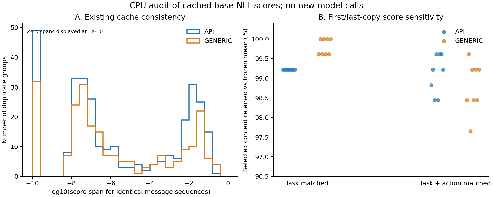

# 基线方法、选择单位与现有数据可行性核对

日期：2026-11-13。本文记录只读文献/代码检查及旧API/generic池的CPU审计；不改变运行中的Stage 4，不新增模型调用或正式测试结果。

## 核对范围和直接来源

| 工作 | 已重点核对 | 实现与来源状态 |
|---|---|---|
| [SmartAD](https://aclanthology.org/2026.findings-acl.1349/) | §3.2–4.4、Appendix A/B；PDF第4页公式已目视核对 | 论文和ACL页面可获取；本次未核实到作者实现，搜索到的同名抗原距离项目与该论文无关 |
| [SkillScaffold](https://arxiv.org/abs/2610.18807v1) | §4.2–5.6、A.1/A.2；第6页公式、ALFWorld组效用实现 | 官方仓库七个本地文件与commit `10d9a155004b0951028822e028fc65cb975ee891`逐blob一致；仅声明该子集身份，不声明整个本地目录已验证 |
| [FutureBridge-OPD](https://arxiv.org/abs/2608.01953v2) | §3、C.2/C.3；第4页验证门、ALFWorld主workflow和OPD advantage实现 | 官方commit `e73603a9acbe5174cdf37f37187e6af7cc4a3f2c`的六个文件已下载、逐blob核验；未安装或执行作者框架 |
| [Frontier-OPD](https://arxiv.org/abs/2610.32802v1) | §3.2–3.4、Appendix A–C；第6页验证/训练公式 | 论文所指`jiangz20/FrontierOPD`在本次浏览及GitHub API读取中均为404，不能由此断言代码从未公开 |

四份本地PDF均与原下载清单SHA一致。这里是针对研究问题的方法审计，不声称已逐字通读所有参考文献、理论证明和附录案例。

## 选择单位是第一处必须补齐的对照

SmartAD对同一输入采样多个正确教师轨迹，按“每个assistant turn内token平均，再对turn等权平均”的NLL选完整轨迹；其主方法另含reason/action/final三段加权。当前Stage 3/4按动作示范选样，每条仍保留真实历史上下文，不能把它描述为完整SmartAD复现，也不能说是在拼接错误历史。[方法定义](https://aclanthology.org/2026.findings-acl.1349.pdf)

下一轮应在同一候选池中分别检验完整轨迹选择和动作级选择，至少保留random/min/median/max-NLL。完整轨迹的分段权重若移植到ALFWorld/WebShop，还需明确定义；没有reason/code/final等价结构时，名称应为“受SmartAD启发的轨迹NLL对照”。样本、token和优化预算分别记录，完整轨迹长度不同不能被“同一条轨迹”掩盖。这个建议不改变当前冻结实验。

## 旧池能够提供多少真实候选？

审计器逐一把corpus目标视图接回原始成功episode、attempt和step，核对train划分、消息、原始连续步骤、过滤理由及NLL缓存行对齐；117条成功原始轨迹均可追溯。以下是旧API/generic来源，不是新API/ReAct比较。

| 指标 | API | Generic |
|---|---:|---:|
| 原始完整成功轨迹 | 68 | 49 |
| 覆盖任务 | 35 | 29 |
| 同题至少两次成功的任务 | 33 | 20 |
| 同题至少两条**不同目标视图完整轨迹**的任务 | 4 | 5 |
| 过滤后仍保留全部监督步骤的轨迹 | 60 | 32 |
| 同题至少两条不同且完整保留的候选任务 | 2 | 1 |
| 原始/过滤后动作标签 | 740/721 | 785/732 |

两次成功多数是完全相同的目标视图，不能当作两个有效选择机会。这里使用精确消息指纹，亦不把字面不同直接当成语义策略不同。过滤移除了19/53条字面`Nothing happens.`标签；后续示范仍保留实际历史，当前缓存不含这些被删步骤的监督NLL，因此不能把剩余动作均值叫作完整原始轨迹NLL。

现有池足以研究已经冻结的动作分布干预；完整轨迹选样需要新的候选多样性检查。下一轮采集先核对同题不同成功轨迹及其覆盖，再安排选样训练。[可复算汇总](../output/trajectory-baseline-feasibility/20261113/aggregate-summary.json)

## NLL缓存数值一致性：先量化影响

相同消息对应的缓存分数并非始终一致。API有303组重复消息，Generic有224组；极差最大分别0.2655/0.2901 nat/token，重复输入的编码长度一致。枚举**不同副本之间的配对**后，同填充长度有30/18对，分差均为0；不同填充长度有273/206对，其中256/196对分差非零。不同批布局与分数变化相关，但尚未用GPU干预定位原因。[逐不同副本配对核对](../output/nll-cache-layout-audit/20261113/distinct-pair-check.json)单列，避免将原汇总中零极差时可能重用同一索引的“极端对”计作独立布局对照。

我们完整再生16份原冻结mean-score选样配方，再分别用每种内容的首/末副本缓存分数替换，得到32个只读敏感性对照。原选样内容保留率为**97.65625%–100%**，最多替换256条内容中的6条。Stage 3的API均替换2条，Generic为0–1条；Stage 4各来源为1–6条不等。这说明观察到数值波动后，不能直接把已完成结果归咎于它；少量关键示范的训练效应仍需实测。首/末副本替换也不是重新评分后的最坏情况界。

数据均来自原缓存，没有重新评分、训练或改动名单。[完整汇总](../output/nll-cache-layout-audit/20261113/aggregate-summary.json)

## 其他强相关方法应怎样进入对照？

SkillScaffold利用有/无skill的配对似然差，并按Scout成功/失败反转或平衡符号，选择正效用skill，联合GRPO后关闭skill路径。因此“差分NLL衡量skill价值”和“训练后撤除skill”已有直接先例。其即时探索效用与我们希望解释的固定预算SFT后能力不是相同终点，后续要测两者是否存在可预测的排序差异。[原论文](https://arxiv.org/abs/2610.18807v1)

FTB与Frontier-OPD要求对学生生成的token计算教师/学生概率，并执行教师桥后的学生续作。普通文本生成接口并不自动提供这种任意序列重评分能力；需要本地教师或经验证支持该操作的端点，不能用返回文本的SFT冒充OPD。FTB固定代码主workflow还存在验证缺失时保留候选、终止桥返回1.0等具体分支，尝试计数及模板资源也需与论文规范逐项对齐，不能直接运行默认8卡配置后称为同预算复现。[FTB方法与代码](https://github.com/ChenChiShui/FutureBridge-OPD/blob/e73603a9acbe5174cdf37f37187e6af7cc4a3f2c/trinity/common/workflows/envs/TCOD/alfworld/futurebridge_workflow.py)，[Frontier方法](https://arxiv.org/abs/2610.32802v1)

Benchmark也需统一：当前64个开发任务、SkillScaffold的134个ALFWorld valid-unseen，以及它的WebShop类别划分并非同一评测。其WebShop验证合并原test/dev后划分ID/OOD；FTB的零样本/离线WebShop报告另用4096–4195等设置。论文表格不能直接拼接这些分数来宣称超过SOTA。

## 接下来的实际顺序

1. 完成当前100模型/6400回合，保留六初始化、所有反例与绝对分数。
2. 做独立短预算NLL评分诊断：固定输入，控制填充、position IDs、计算精度和输出logits窗口，确认选样依据的稳定性；不重写原缓存或旧结论。
3. 执行已冻结的WebShop train-only 64回合基础校准，核对接口、成功率和动作错误；然后再冻结正式采集、训练与测试协议。
4. 新池先确认不同成功轨迹的覆盖与数量，加入完整轨迹/动作级选择和强简单基线，再检验机制迁移。同时补足原API/ReAct全经验、足够训练消耗的比较。

现有结果是论文的实证起点。新增审计让后续比较的单位、实现和开销可解释，不预设现有方法必须胜出或失效。
