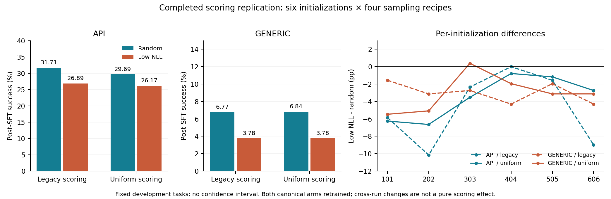

# 统一评分复现：完整结果与解释

2026-11-13。96/96新模型、6,144回合完成，零失败、零未结算预留；14.350136累计GPU小时，18小时上限。287项冻结输入、96个模型训练/组合权重及全部逐任务评测重新核验；W&B最终四文件下载后与本地逐字节一致。控制器和观察器正常结束，半小时监督器仍存活。

## 同轮主要对比

| 来源 | 新随机成功率 | 统一评分低NLL成功率 | 低NLL−随机 | 胜/平/负 |
|---|---:|---:|---:|---:|
| API | 29.687500% | 26.171875% | −3.515625pp | 10/0/14 |
| Generic | 6.835938% | 3.776042% | −3.059896pp | 5/3/16 |

六初始化×四采样配方，两策略均重新训练，所有配对保留；主要均值不使用历史模型代替新随机对照。

| 初始化/Dropout种子 | API低NLL−随机 | Generic低NLL−随机 |
|---|---:|---:|
| 101 | −6.250000pp | −5.468750pp |
| 202 | −6.640625pp | −5.078125pp |
| 303 | −3.515625pp | +0.390625pp |
| 404 | −0.781250pp | −1.953125pp |
| 505 | −1.171875pp | −3.125000pp |
| 606 | −2.734375pp | −3.125000pp |

API六初始化均值均负；Generic五负一正。24个采样配对不视为24个独立初始化。沿用已反复查看的64个开发任务，未打开官方最终测试，不给未经校准的显著性或等效结论。

## 与旧评分研究分开比较

| 来源 | 旧随机→新随机 | 旧低NLL→新低NLL | 两策略新−旧变化 |
|---|---:|---:|---|
| API | 31.705729%→29.687500% | 26.888021%→26.171875% | 随机−2.018229pp；低NLL−0.716146pp |
| Generic | 6.770833%→6.835938% | 3.776042%→3.776042% | 随机+0.065104pp；低NLL+0.000000pp |

旧主要差为API −4.817708pp、Generic −2.994792pp。API差距收窄约1.302083pp，同时新随机组分数下降更多；不能把差距变化全部归因于重评分。Generic负差几乎不变。

统一无padding、显式位置、固定logits窗口的评分及重新选样没有将主要平均方向翻转。这个受控失败案例在本次评分统一处理下复现，补齐了审稿意见中“数值一致重评分后的训练复现未完成”这一缺口。它不证明低NLL样本普遍有害，也不证明harness优越、跨环境泛化或一个已识别的机制。

## 后续证据与已有边界

优先固定新任务及共同强执行方式，再加入中/高NLL与有效的强选样基线；以corpus为单位验证学习价值预测器及选样干预。WebShop已有起点校准，正式学习复现仍待单独固定方案。原API−ReAct matched-success负向来源比较继续保留，全经验来源比较也未被本次API/Generic选样实验替代。

当前稿件需要把统一评分训练的状态由“进行中”更新为“完成”，同时保留原版本；本次完成一个明确的审稿缺口，其他机制和泛化缺口仍按既定路线推进。

[完整汇总](../output/variance-diagnostic-v1/stage5-canonical/aggregate-summary.json) · [独立本地复核](../output/research-operations/20261113/canonical-complete-local-check.json) · [云端字节核验](../output/research-operations/20261113/canonical-complete-cloud-check.json) · [W&B最终结果](https://forge.coreweave.com/wandb/yanyaoyuan-jawaharlal-nehru-university/learning-harness-lab/runs/3d16840d5eb1)
