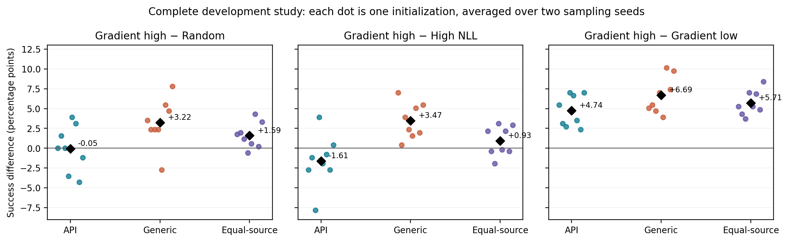

# 新任务经验学习价值：完整开发实验复盘

2026-11-17。状态：完整开发矩阵结束，本地原始记录审计、云端汇总文件和训练摘要核验均通过。本文件是完成后的描述性复盘，原开发协议、各中途节点和历史负向实验保持原样。

## 完成规模与可复核证据

224个重新训练的学生、一个基础模型，共225个模型和28,800回合；八初始化×两采样种子×两历史经验来源×七选择规则。每模型在相同128个新开发任务上评测，放置/清洗各64。零失败模型，607,700次请求均有响应记录，零请求错误或未知用量。累计62.1458 GPU小时含既定准备成本。11月17日05:55主实验结束，05:56汇总归档完成。

最终汇总为 `output/experience-value-development-v1/aggregate-summary.json`，SHA256 `a5e1893dfcd9276361abd8504b24a4ed47e08fd72156af59fd51b29a66f8fe1e`。独立审计从原始回合、事件、请求、训练预算和权重重建全部结果，并核验509个冻结输入。审计记录为 `output/experience-value-completion-audit-v1/local-audit.json`。

云端最终及1/2/4/8/16块节点共六个工件、18个文件已下载核对哈希，224个原生学生训练摘要与本地结果一致，见同目录 `cloud-audit.json`。原自动审计的模型环境缺少wandb依赖，已通过现有W&B环境中的只读核验脚本补齐；原失败日志和中断尝试均保留，未重跑训练或修改冻结源文件。这里只核验224个学生的结束摘要；不是224条训练历史全部逐点重新审计，早前88条完整曲线核验另有记录。

## 完整成功率

| 选择规则 | API历史池 | Generic历史池 |
|---|---:|---:|
| Random | 77.344% | 68.652% |
| Gradient high | 77.295% | 71.875% |
| High NLL | 78.906% | 68.408% |
| Low NLL | 72.070% | 67.627% |
| Middle NLL | 73.975% | 68.750% |
| Gradient low | 72.559% | 65.186% |
| Gradient global | 81.445% | 73.193% |

同一128任务上的基础模型成功率为67.188%。不能拿此前32任务校准值作这里的学习增益基线。Global排序未控制任务/动作覆盖，须单列；它的较高成功率不能全部解释为受控内容质量的作用。

## 预定对比与逐初始化复查

下表单位均为成功率百分点；先平均两采样种子，再对两个来源等权平均。

| 对比 | API | Generic | 来源等权 | 初始化正/平/负 |
|---|---:|---:|---:|---:|
| Gradient high − Random | −0.049 | +3.223 | +1.587 | 7/0/1 |
| Gradient high − High NLL | −1.611 | +3.467 | +0.928 | 4/0/4 |
| Gradient high − Gradient low | +4.736 | +6.689 | +5.713 | 8/0/0 |

| 初始化 | High − Random | High − High NLL | High − Low gradient |
|---|---:|---:|---:|
| 101 | +1.758 | +2.148 | +5.273 |
| 202 | +1.953 | −0.391 | +4.297 |
| 303 | +1.172 | −1.953 | +3.711 |
| 404 | −0.586 | +3.125 | +7.031 |
| 505 | +0.586 | −0.195 | +5.273 |
| 606 | +4.297 | +2.148 | +6.836 |
| 707 | +0.195 | −0.391 | +4.883 |
| 808 | +3.320 | +2.930 | +8.398 |

16个配对采样块的high−low全为正；它们对应八个初始化，不能写成16个独立初始化。逐初始化图由 `scripts/analyze_experience_value_final.py` 从最终模型汇总重建，每个点已经平均两个采样种子，图中黑色菱形是八初始化均值，不是置信区间。

## 这轮实验实际推进了什么

新任务上的受控高/低梯度干预具有一致的收益方向。这比单独观察Low NLL不如Random更接近可研究的经验价值信号：控制任务/动作调度及独特内容配额后，按评分选择的内容仍会改变训练后的行为表现。前述控制没有把文本长度、动作细节、状态分布或语义难度逐一匹配，因此尚不能把差异唯一归因为梯度对齐机制。

对简单选样规则的优势依赖来源。Generic中Gradient high比Random高3.223pp、比High NLL高3.467pp；API中与Random接近、比High NLL低1.611pp。论文应同时呈现两种现象，区分“评分能分出高低学习收益”和“评分普遍优于强基线”。当前可支持前者的开发证据，后者仍需验证。

按任务族拆分，Generic的Gradient high相对Random在放置上高2.344pp，在清洗上高4.102pp；API分别为−0.195pp、+0.098pp。这是完成后的描述性切分，不能据此另选一个任务族作为主结果。

## 需要继续排查的解释

固定768次呈现和192次更新不等于固定token预算。API的Gradient high平均476,314输入token、Gradient low为500,016，前者少4.740%；Generic分别510,404和527,626，少3.264%。不能只用“高分消耗更少token”宣称计算效率提升：评分本身也有成本，而且文本长度可能与经验难度、状态冗余等因素相关。受控长度实验应同时比较Random、High NLL和高/低梯度，检查梯度在长度之外的增量价值。

所有数据仍来自两个历史经验池、同一骨干和ALFWorld文本环境。28份固定调度/语料条件相互重叠，并非28个独立采集池；224个训练学生也不是224个独立语料。现有结果不等于跨环境预测，也不等于机器人/VLA评测、持续学习或后续适应效率结果。原API来源与ReAct自采的公平来源对照尚未完成，不因本实验而改写该结论。

## 下一步的顺序

1. 用开发集的配对二值结果校准任务×初始化推断及功效，保留来源差异、两采样重复和任务族结构。只做CPU统计，确认任务不调用模型。
2. 冻结确认协议后，复用现有权重评测封存的新任务。Random、High NLL、Gradient high和Gradient low一同保留，预先确定检验、多重比较和预算，不根据确认结果挑来源或换指标。
3. 在现有池上先做长度匹配可行性检查；有足够评分变化时，再建立长度控制的新调度与训练对照。不能把确认新任务当作长度干预的替代。
4. 按确认与长度对照共同决定论文主张。第二环境学习复现用于检验外推，另行制定收集和SFT协议；此前WebShop运行只是接口校准。

当前不报告未经校准的显著性或等效结论，确认集和官方测试仍未执行。完整最终表、受控高低干预、来源异质性和全部失败解释应一起进入下一版论文，不覆盖原稿历史版本。
