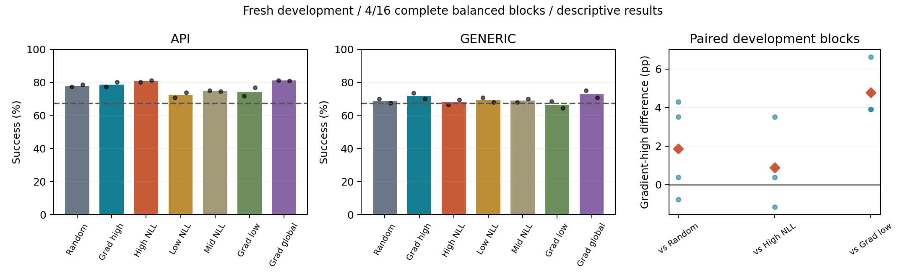

# 学生开发学习对照：预定四块节点核验

本报告仅解读已冻结的第4块预定节点：56个学生加一个基础模型，共7296回合；初始化101/202，各配两个采样种子。当前主队列已经前进到后续块，不将尚未完成的块混入这些比较。

基础模型在相同128个新开发任务上的成功率为67.188%。

| 规则 | API来源 | Generic来源 |
|---|---:|---:|
| random | 77.930% | 68.750% |
| gradient_high | 78.711% | 71.680% |
| high | 80.664% | 67.969% |
| low | 72.266% | 69.336% |
| middle | 74.805% | 68.945% |
| gradient_low | 74.414% | 66.406% |
| gradient_global | 81.055% | 72.852% |

## 预定比较

- 梯度高分−随机：来源均衡平均+1.855个百分点，四个配对块3胜/0平/1负。
- 梯度高分−高NLL：来源均衡平均+0.879个百分点，四个配对块3胜/0平/1负。
- 梯度高分−梯度低分：来源均衡平均+4.785个百分点，四个配对块4胜/0平/0负。

高/低梯度的四块差值方向一致，值得按原计划继续验证完整八初始化。梯度高分对随机的平均差值较小；对高NLL也不是每个来源都更好：API来源梯度高分比高NLL低1.953个百分点，Generic来源高3.711个百分点。保留这一来源差异，不宣称已普遍胜过简单高NLL。

global排序在当前节点两来源均较高，但它没有控制任务/动作覆盖，不能将其全部收益归因为覆盖受控的梯度干预。四块只涉及两个初始化，不是四个独立初始化；不报告显著性、置信区间或等效结论。

## 核验和执行

从原始回合、事件、生成请求、训练预算和权重重新核验57个模型，重建第1/2/4块三个预定节点，全部一致；同初始化的初始参数哈希跨条件一致。三个云端节点共9个白名单汇总文件下载后逐字节一致；87个已完成学生的原生W&B摘要均已核对，没有发现缺失。

主队列、主W&B观察器、原生训练记录器和半小时监督器均核验为真实存活；48次周期检查间隔约1801秒，无监测中断。日志中的间歇服务导出警告没有导致已核对的节点文件或学生摘要缺失，不据这些警告重启GPU作业。

继续原224学生矩阵、GPU0串行，GPU1其他任务不动；下一固定报告节点为8个完整块。当前尚未结束；确认集和官方测试保持封存，原来源对照与既有负向结果保留。
