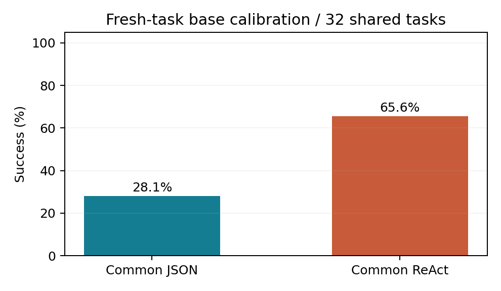

# 新任务基础模型校准：完整结果与下一步

64/64回合已完成，两个执行条件均无运行失败、请求记账完整，GPU0实际计账491.897秒（8.20分钟）。代码和输入329项在首次模型调用前冻结；旧237/287/67/61项输入再次核验均未变化。

## 观察到的结果

同一Qwen3-4B-Instruct-2507基础模型、同32个新放置/清洗任务，无adapter、无教师、每回合40次调用上限：

| 执行方式 | 放置成功/16 | 清洗成功/16 | 合计成功/32 | 请求数 | 输入token | 输出token | GPU秒 |
|---|---:|---:|---:|---:|---:|---:|---:|
| Common JSON | 7 | 2 | 9（28.125%） | 1,098 | 755,460 | 12,305 | 164.043 |
| Common ReAct | 10 | 11 | 21（65.625%） | 703 | 1,316,301 | 13,858 | 327.855 |

逐任务配对：9个两者均成功、12个仅ReAct成功、0个仅JSON成功、11个均失败。两条件格式错误均0；ReAct有260次thought决定，计入调用与回合预算。相同调用上限不等于相同token或耗时，ReAct调用总数较少但输入token和耗时较高。

这说明新任务接口可用，公开ReAct提示提供了明显更好的基础执行起点，并留下改善空间。它让下一步能够检查选样收益是否受部署执行方式影响。这里比较的是基础模型的两种提示执行方式；尚没有新SFT收益或学习价值预测结果。

## 新任务与正式评测的关系

它们来自官方训练池内、此前历史清单和执行记录之外的任务组。按任务组排除公开示例重置指纹重合；校准32、开发128、确认128三组已经固定并隔离。只有校准集执行了模型动作；另外两组仅做了准备阶段reset审计，没有查看成功率。

原训练池冷却任务组已经用尽、加热仅余16组，故新任务预先扩展到放置/清洗。这是任务范围扩展，不能替代独立环境学习复现，也不是官方seen/unseen成绩。官方测试仍未开启。

## 已完成的下一轮准备

中/高/低/随机共32份候选训练清单已落盘，保持768次呈现、256个独特任务内容及逐位置任务/动作配额；低/随机与完整canonical实验一致。实际输入和目标token也已核算。四条公开示例生成40个独立目标支持候选，供强梯度基线接入；没有查询答案泄漏和新API调用。LESS官方实现已固定版本并保存参考。

预计单模型在128开发任务上跑两执行方式约32.8分钟；若直接扩为192模型，约105累计GPU小时，未含训练/特征提取。因此下一项是固定可负担的开发矩阵、强基线实现和统计方案，再训练；128确认任务保持封存。具体工作单见[下一阶段研究方案](EXPERIENCE_VALUE_NEXT_STUDY_2026-11-13.zh-CN.md)。

## 运行和记录

冻结SHA：`d66fc9ceb9f29e197efe8d867ff95d87da4829322a75a4e2025b1ac11c700f61`。结果汇总SHA：`d284e6d577ddb563cb02e7d26aa59e9f1a8ac3e0133503590f8eaf6b49a9999b`。

W&B观察器首次因连接文件缺少host字段退出。独立恢复脚本使用W&B配置的默认API地址，保持原冻结观察器、评测代码和输入不变；评测没有重启。云端上传范围为汇总JSON、PNG、结果说明三文件，不含任务清单、原始轨迹或请求日志。[W&B完整结果](https://forge.coreweave.com/wandb/yanyaoyuan-jawaharlal-nehru-university/learning-harness-lab/runs/d66fc9ceb9f2)。

两项GPU条件及观察器均已正常结束。半小时监督器保留终态记录，不自动重启已完成任务。
