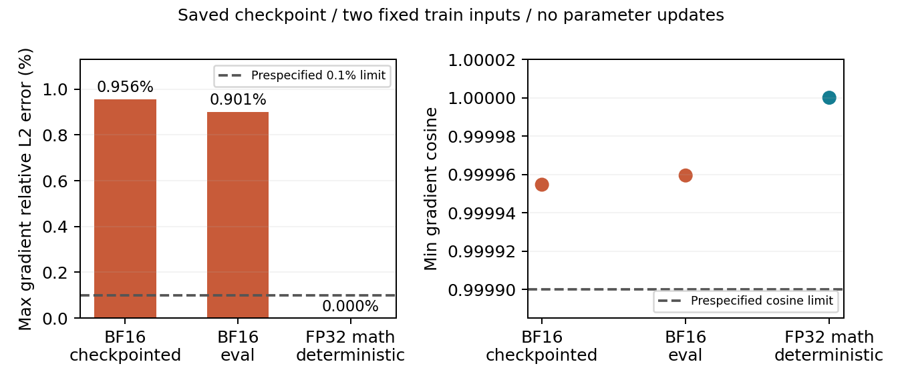

# 强选样基线：数值诊断与当前执行

新阶段已进入真实GPU预热和梯度提取。它产生选择规则，最终学生及其新任务成功率仍需后续学习实验。

## 已完成的实现和诊断

- 实现与固定版本LESS官方表达式一致的Adam状态相关更新特征；独立有限差分检查通过。
- 完整LoRA维度的候选/目标梯度余弦，流式支持均值与显式相似度矩阵一致；先跨检查点加权，再取目标任务族最大值。
- 旧BF16试验完成8次预热更新、32次样本呈现，在第一条支持梯度的重复性门槛停止；计账16.091秒，未产生最终选择分数。失败记录、检查点及91项冻结输入保留。
- 独立固定检查点诊断执行18次forward/backward，无参数更新和新任务评测，计账9.780秒。两个输入的BF16重复梯度最大相对L2误差分别汇总为：checkpoint模式0.956%、eval模式0.901%；原门槛为0.1%。FP32数学后端及确定性算法组合下，各次重复逐元素一致，误差0。此比较同时改变精度与执行设置，不声称单独识别某个内核的因果作用。

## 当前运行的修订

[FP32修订规范](OPTIMIZER_AWARE_SELECTION_FP32_SPEC_2026-11-13.zh-CN.md)固定103项输入，从固定种子重新预热，模型/LoRA/特征均FP32，强制数学注意力、确定性算法并关闭TF32。误差门槛保持原样；前述25.871秒计入同一2 GPU小时上限。

预热使用历史候选并集853个不同内容中的43个，128次呈现、32次更新。更新8/16/24/32后分别对853候选及40公开支持动作评分。目标支持只求梯度，不参与预热。四检查点完整后才组合分数，生成任务/动作/内容预算匹配与全局排序两类候选清单；它们仍需从原基础模型训练最终学生。

首次完整检查点已通过全部候选评分和权重、优化器、随机流不变检查。后续进度以本地 `execution.json`、`progress.json` 和[W&B运行](https://forge.coreweave.com/wandb/yanyaoyuan-jawaharlal-nehru-university/learning-harness-lab/runs/245af834c728)为准。没有用未完成的分数宣称学习收益。

## 排队的接口校准

[JSON兼容公共示例校准](JSON_PUBLIC_EXAMPLES_CALIBRATION_SPEC_2026-11-13.zh-CN.md)已固定348项输入、32回合，排在特征提取完成后，在GPU0串行运行。它保留原JSON指令、输出解析和历史，只增加公开示例，用于检查原JSON/ReAct对比中的输出格式迁移风险。

前序失败则队列停止；GPU0被其他任务使用则拒绝启动。不自动重启任何阶段。每阶段独立半小时监督，云端只记录汇总。GPU1上的其他任务保持原样。128开发、128确认及官方测试均未进入本阶段评测。
