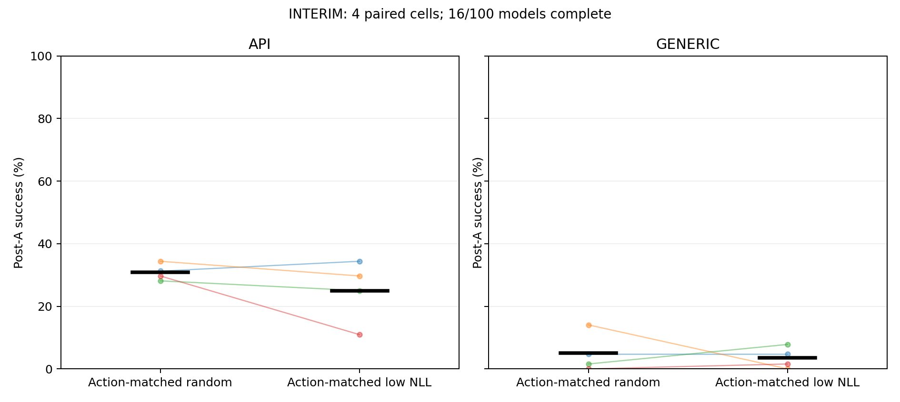

# Stage 4：动作构成匹配的中途观察

描述性观察记录。完整研究冻结100模型/6400回合，六初始化×四采样配方，条件重复单列。中途节点1/4/8/12/16/20/24在新训练前固定；继续全部队列，不按观察方向换种子或提前停止。

## 节点1：首个完整配对单元

2026-11-13 01:47，初始化101、采样配方101，两来源/两策略共4模型、256回合齐全。原始回合、调度、权重及零B组成通过报告入口审计，中途图已由实际观察器生成并上传W&B。它是1/24个主配对单元，尚无跨初始化重复性证据。

| 来源 | 随机成功率 | 低NLL成功率 | 低NLL−随机 |
|---|---:|---:|---:|
| API | 31.2500% | 34.3750% | +3.1250pp |
| Generic | 4.6875% | 4.6875% | 0.0000pp |

| 来源/策略 | 冷却 | 加热 |
|---|---:|---:|
| API随机 | 25.0000% | 37.5000% |
| API低NLL | 15.6250% | 53.1250% |
| Generic随机 | 9.3750% | 0.0000% |
| Generic低NLL | 3.1250% | 6.2500% |

这一单元没有重现Stage 3同来源内的平均负差异；两个任务族的方向也不同。它为继续检查动作构成提供早期观察，不能当作动作构成已经解释原差异、证明等效或得到总体正效应。动作匹配还改变了可用内容支持和NLL选择强度，完整对比须同时报告。

所有均值只使用已配齐的repeat=0模型；没有少种子bootstrap区间。固定开发集、单个初始化和单个配方的范围保留，后续节点和最终六初始化结果另列。

[汇总数据](../output/variance-diagnostic-v1/stage4/interim/node-01/aggregate-summary.json) · [W&B进度与中途图](https://forge.coreweave.com/wandb/yanyaoyuan-jawaharlal-nehru-university/learning-harness-lab/runs/76f7e74a6c3b-progress)。仅汇总JSON和PNG/PDF进入云端，逐任务记录保留本地。观察器首次完整GPU→审计→绘图→云端链路已实际执行；这不代表100模型全队列已完成。

## 节点4：首个初始化的四个采样配方齐全

node-04固定快照包含16模型/1024回合、4个主配对单元，均为初始化101；不是四个初始化。原观察器已经完成检查点/调度/逐任务结果审计和PNG/PDF生成、汇总云端上传。

| 来源 | 新随机成功率 | 新低NLL成功率 | 低NLL−随机 |
|---|---:|---:|---:|
| API | 30.859% | 25.000% | −5.859pp |
| Generic | 5.078% | 3.516% | −1.563pp |

API四配方胜/平/负为1/0/3，generic为2/1/1；仍是单初始化的描述性观察。节点1保留，其单元API正向不被删除；随后三个单元配齐后均值变为负向。

### 事后历史参照审计

新结果中generic随机组较低，因此增加了固定旧随机参照的描述性核对，而不只比较差值。与**同一初始化101**的Stage 3相比：

| 来源 | 旧随机 | 旧低NLL | 新随机 | 新低NLL |
|---|---:|---:|---:|---:|
| API | 26.953% | 11.719% | 30.859% | 25.000% |
| Generic | 11.719% | 3.125% | 5.078% | 3.516% |

API低NLL组提高13.281pp、随机提高3.906pp；generic低NLL仅提高0.391pp、随机下降6.641pp。因此差距缩小对应不同的绝对表现变化。对固定旧随机，新低NLL仍分别低1.953pp和8.203pp。完整[补充图表与控制核对](../output/variance-diagnostic-v1/stage4/historical-reference-audit/node-04/RESULTS.zh-CN.md)保留全部四配方，不给未经校准区间。

这是观察结果后增加的历史跨轮比较，明确标为post hoc。检查了初始参数、训练器、优化器、源数据、呈现次数和GPU，并验证新配额来自对应旧随机调度；它仍不能把内容支持/NLL强度变化分离成纯动作构成的因果效应。原新随机/低NLL主要比较和六初始化完整队列继续，不按此观察改种子、预算或提前停止。
