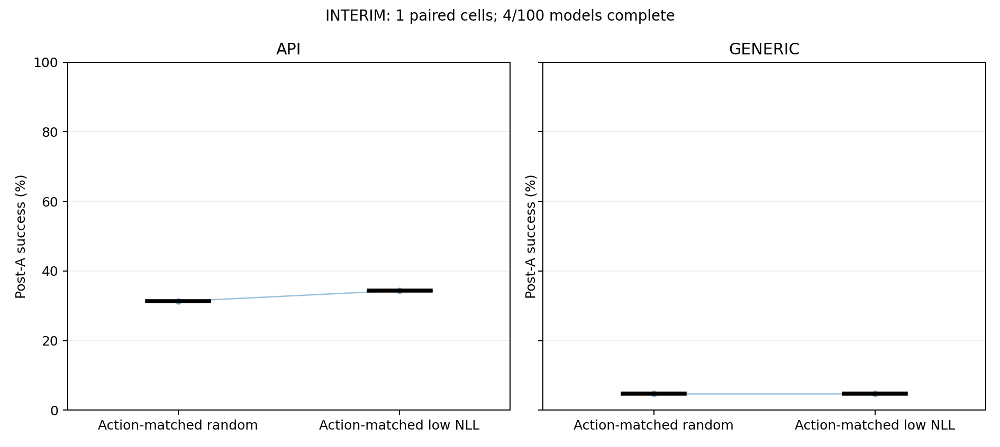

# Stage 4：动作构成匹配的中途观察

描述性观察记录。完整研究冻结100模型/6400回合，六初始化×四采样配方，条件重复单列。中途节点1/4/8/12/16/20/24在新训练前固定；继续全部队列，不按观察方向换种子或提前停止。

## 节点1：首个完整配对单元

2026-11-13 01:47，初始化101、采样配方101，两来源/两策略共4模型、256回合齐全。原始回合、调度、权重及零B组成通过报告入口审计，中途图已由实际观察器生成并上传W&B。它是1/24个主配对单元，尚无跨初始化重复性证据。

| 来源 | 随机成功率 | 低NLL成功率 | 低NLL−随机 |
|---|---:|---:|---:|
| API | 31.2500% | 34.3750% | +3.1250pp |
| Generic | 4.6875% | 4.6875% | 0.0000pp |

| 来源/策略 | 冷却 | 加热 |
|---|---:|---:|
| API随机 | 25.0000% | 37.5000% |
| API低NLL | 15.6250% | 53.1250% |
| Generic随机 | 9.3750% | 0.0000% |
| Generic低NLL | 3.1250% | 6.2500% |

这一单元没有重现Stage 3同来源内的平均负差异；两个任务族的方向也不同。它为继续检查动作构成提供早期观察，不能当作动作构成已经解释原差异、证明等效或得到总体正效应。动作匹配还改变了可用内容支持和NLL选择强度，完整对比须同时报告。

所有均值只使用已配齐的repeat=0模型；没有少种子bootstrap区间。固定开发集、单个初始化和单个配方的范围保留，后续节点和最终六初始化结果另列。

[汇总数据](../output/variance-diagnostic-v1/stage4/interim/node-01/aggregate-summary.json) · [W&B进度与中途图](https://forge.coreweave.com/wandb/yanyaoyuan-jawaharlal-nehru-university/learning-harness-lab/runs/76f7e74a6c3b-progress)。仅汇总JSON和PNG/PDF进入云端，逐任务记录保留本地。观察器首次完整GPU→审计→绘图→云端链路已实际执行；这不代表100模型全队列已完成。
