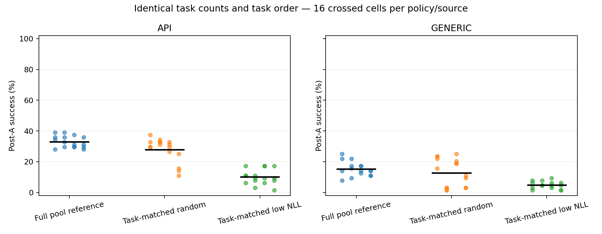
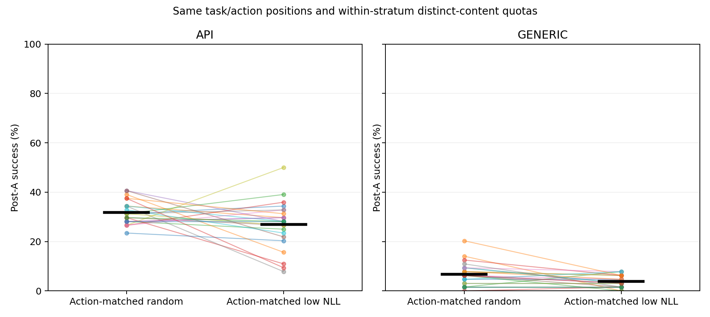
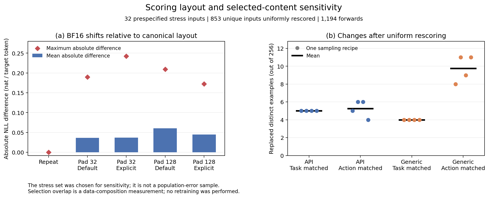
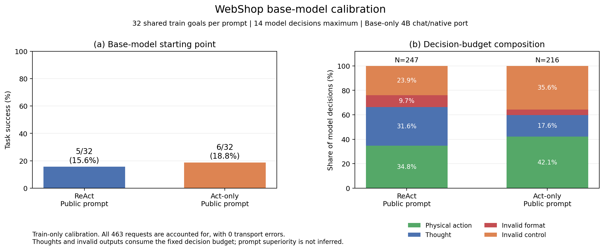

# Controlling Experience Composition in Language-Agent Fine-Tuning

**Working manuscript v0.2 — 13 November 2026.** Stages 2–4, an independent scoring diagnostic, and a train-only WebShop base calibration are complete. This revision replaces the node-12 interim with the complete Stage 4 primary comparison and separately reported repeats. Second-environment learning validation remains open. The sealed official evaluation sets remain unused. Authors, venue, and submission date are unset.

## Abstract

Successful agent trajectories provide training data, but their downstream value also depends on which experiences enter the optimization budget. We study experience composition in supervised fine-tuning of a 4B language agent in the ALFWorld text environment. Two existing collection pools allow within-source comparisons under a fixed execution interface. At equal presentation and update budgets, a complete-pass schedule improves mean task success over subset replay by 5.18 and 1.27 percentage points in the two pools. We then match task exposure, task order, and distinct-content budgets while comparing random selection with selection by low base-student action negative log-likelihood. Across four initialization/dropout seeds and four sampling recipes, low-NLL selection reduces mean success by 17.77 and 7.81 points; the initialization-level mean difference is negative in both pools at every seed. These results establish a concrete failure of this action-level predictability proxy under the studied controls. In the completed action-composition control, the corresponding differences are −4.82 and −2.99 points across six initialization/dropout seeds and four sampling recipes. Uniform rescoring retains 95.70%–98.44% of selected content, but its changed selections have not been retrained. A second-environment base calibration establishes an executable interface, rather than replication of the learning result. We report collection sources, selection units, seed roles, actual training consumption, and retained counterexamples separately.

## 1. Introduction

Agent systems can improve task completion through prompts, skills, memory, tools, or external guidance. When their trajectories are subsequently used for training, a second question arises: which experiences improve the student after the collection-specific assistance is removed? Collection success measures the behavior of the collecting system. A selection score measures a property of candidate data. Post-training success measures the behavior of an updated model under a specified executor. These quantities require separate evidence.

Our initial teacher-assisted collection versus ReAct self-collection experiment did not establish an advantage for the candidate pipeline. Its matched-success comparison produced a mean API-minus-ReAct adaptation-AUC difference of −3.56 percentage points across three training seeds. This result is retained throughout the present investigation. The subsequent experiments ask a narrower question: within a fixed historical source pool, how do sampling and content selection affect post-SFT behavior when budget and experience-composition factors are progressively controlled?

We examine two existing experience pools using the same student, optimization configuration, and common executor. A sequence of controlled studies first distinguishes presentation budget from experience support, then matches task exposure and distinct content, and finally constrains task-by-action composition. The completed task-matched study shows lower post-SFT success for low-NLL selection than for random selection with the same task and distinct-content budgets. A residual difference remains after matching task-by-action composition. This supports a controlled failure case for this action-level selector; it does not identify a general causal mechanism or evaluate all student-likelihood methods.

The contribution of this version is an empirical comparison with explicit control boundaries: a progressively constrained experience-selection protocol, completed results on two source pools, and audits separating training variability, scoring consistency, and historical reference changes. A transferable mechanism or improved selector requires the remaining studies. The two pools are two collection conditions in one environment.

## 2. Related Work and Comparison Units

**Learning from assistance.** [SkillScaffold](https://arxiv.org/abs/2610.18807v1) already studies skill utility, training with skills, and deployment without the skill path. [EvoHeir](https://arxiv.org/abs/2610.22029v1) separates task admission, realized model updates, parameter inheritance, and experience retention. These works establish direct precedents for distinguishing apparent opportunities from useful learning. Our present comparison concerns fixed-budget experience selection and post-SFT behavior in a controlled interactive-agent setting.

**Predictability and selection.** [SmartAD](https://aclanthology.org/2026.findings-acl.1349/) selects complete correct teacher trajectories using student likelihood and additionally weights trajectory segments. Our current selector operates on individual action demonstrations, each retaining its genuine historical context. It is an action-level baseline, and a full SmartAD comparison remains to be implemented. [Rho-1](https://arxiv.org/abs/2404.07965) uses excess token loss relative to a reference model, rather than raw student loss. It motivates a separate reference-loss comparison whose reference-training cost must be accounted for.

**Targeted selection and interpretation.** [LESS](https://proceedings.mlr.press/v235/xia24c.html) uses warmup training and optimizer-aware gradient features to select examples relative to target demonstrations. It supplies an existing stronger baseline with additional supervision and compute. [Form Over Content](https://arxiv.org/abs/2609.19589v1) studies the sensitivity of gradient attribution to answer format. Its analysis motivates format controls without implying that our own performance differences have already been explained by format. Cross-paper scores are not combined when the backbone, task split, executor, or available support differs.

## 3. Experimental Setting

### 3.1. Environment, student, and experience pools

The current experiments use ALFWorld's text interface for multi-step household tasks. They evaluate language-agent interaction, rather than visual robot control. The student is Qwen3-4B-Instruct-2507 at revision `cdbee75f17c01a7cc42f958dc650907174af0554`.

The two historical pools are named **API** and **Generic**. Their eligible training corpora contain 721 and 732 action-demonstration rows, respectively, covering 35 and 29 collection tasks. Exact message-content deduplication yields 418 and 508 distinct records. Source names identify collection conditions; they do not define randomized treatments or independent environments. All new controlled studies reuse these pools and make zero additional teacher calls.

Each action example contains the actual student-view messages preceding its target action. Sampling examples does not fabricate an interaction history. However, selecting individual examples and selecting complete trajectories are different interventions. A separate provenance audit traced 117 original successful trajectories and found only two API tasks and one Generic task with multiple distinct, fully retained eligible trajectories. This limits the choice space for a meaningful complete-trajectory selection comparison in the old pools.

### 3.2. Training and evaluation

The controlled selection studies use BF16 LoRA SFT with rank 16, alpha 32, dropout 0.05, and the attention projections `q_proj`, `k_proj`, `v_proj`, and `o_proj`. The learning rate is 10⁻⁴, weight decay is zero, and the warmup ratio is 0.05. Each compared model receives 192 updates at global batch size four, totaling 768 sample presentations, with maximum sequence length 2,048. Input and target tokens are reported separately; equal presentation counts do not establish equal FLOPs.

Evaluation uses the same repeatedly inspected development tasks: 32 cooling and 32 heating tasks, weighted equally, with environment seed 11, temperature zero, and batch size eight. The inherited step-0 artifact consists of the trained A adapter and a zero-initialized, untrained B adapter; the composition is audited. Collection-specific assistance cards are withdrawn. The common executor's fixed public instructions and examples remain part of the evaluation condition.

The official seen/unseen evaluation sets remain sealed. These development experiments are exploratory. Historical source comparisons show substantial executor dependence, so extension to a common stronger executor and fresh evaluation tasks is a required validation step.

### 3.3. Seed roles and reported estimands

An initialization seed controls LoRA initialization and the dropout stream. A separate sampling seed controls the training schedule or selection recipe. We cross these roles rather than treating every trained adapter as an independent initialization.

Let $Y_{s,p,i,j,f,t}$ indicate success for source $s$, policy $p$, initialization/dropout seed $i$, sampling recipe $j$, task family $f$, and task $t$. A model's score is

$$
R_{s,p,i,j}=\frac12\sum_{f\in\{\mathrm{cool},\mathrm{heat}\}}
\frac1{32}\sum_{t=1}^{32}Y_{s,p,i,j,f,t}.
$$

The within-source contrast is

$$
\Delta_s=\frac1{IJ}\sum_{i=1}^{I}\sum_{j=1}^{J}
\left(R_{s,\mathrm{lowNLL},i,j}-R_{s,\mathrm{random},i,j}\right).
$$

We also report each initialization's average over the four sampling recipes, every paired cell, and wins/ties/losses. Conditional training repeats are reported separately and excluded from primary means. Repeated evaluations of the same development task do not create new task identities.

No calibrated population confidence interval is claimed in these stages. Earlier frozen reports retain their original bootstrap analyses, but normal-outcome calibration exposed a failure of a three-seed percentile procedure in some scenarios. Binary-outcome calibration and a new confirmatory design remain required before formal inferential claims.

## 4. Progressive Controls

**Stage 2: full-pass exposure versus subset replay.** Both arms receive 768 presentations and 192 updates. The complete-pass arm visits the entire eligible corpus before repeating examples. The replay arm reuses a 256-row subset. Membership, frequency, and order can change together, and source-specific task mixtures retain differences. This comparison tests the schedule intervention as a whole.

**Stage 3: task exposure and content budget.** Random and low-NLL selection are matched within source on task identity at each training position, task presentation counts, 256 distinct message-content records, and optimization budget. The low-NLL policy selects lower-scoring content under the allowed task quotas. Scores are computed with the fixed base student before training; the original implementation averages cached scores of identical content copies. Action composition can still differ.

**Stage 4: task-by-action composition.** The follow-up additionally matches action type at each position and the task/action-specific distinct-content quotas. These quotas derive from the corresponding Stage 3 random reference. They restrict the available content support and weaken the NLL-selection contrast: the frozen design reports approximately 66.15% and 40.44% of the preceding contrast retained in API and Generic. Changes between stages therefore cannot identify an action-composition mediation fraction on their own.

Stage 3 uses four initialization seeds crossed with four sampling recipes. Its 70 new models comprise 64 primary models, four conditional retrains, and two fresh full-pass checks. Stage 4 freezes six initialization seeds crossed with four sampling recipes, two sources, and two policies, plus four conditional retrains: 100 models and 6,400 evaluation episodes in total. Its cumulative GPU cap is 18 hours on two RTX 5090s. The queue and budget are fixed before outcomes and do not change based on observed direction.

## 5. Results Available in This Version

### 5.1. Retained source-comparison result

The separate API-versus-ReAct source experiment completed 4,284 evaluations. Collection succeeded in 69/144 API-assisted attempts and 110/144 ReAct attempts. Matching their 58 common successes controls the task/sample keys used for SFT, while discarding the unmatched coverage difference from that particular training comparison. The primary raw adaptation-AUC difference is −3.56 percentage points; the three seed values are −9.77, −3.42, and +2.49 points. A larger gain relative to the API student's lower starting point does not establish superior final ability or raw AUC. A sufficiently consumed, full-eligible-data comparison remains open.

### 5.2. Completed schedule intervention

Stage 2 completed 68 new models and 4,352 new evaluation episodes. Full-pass exposure improves mean success over subset replay by **5.176 points for API** and **1.270 points for Generic** at the same presentation/update budget. The source-contrast sampling standard deviations within the four initialization blocks decrease from 8.87/13.46/18.55/19.36 to 3.83/6.31/5.90/2.34 points. These are descriptive standard deviations over four recipes, not calibrated variance intervals. Remaining task-mixture differences motivate the subsequent task control.

### 5.3. Completed task-matched selection

Stage 3 completed 70 new models and 4,480 new evaluation episodes. The primary policy comparison is:

| Source | Random success | Low-NLL success | Low NLL − random | Paired wins/ties/losses |
|---|---:|---:|---:|---:|
| API | 27.930% | 10.156% | −17.773 pp | 1/0/15 |
| Generic | 12.695% | 4.883% | −7.812 pp | 5/0/11 |

| Initialization/dropout seed | API difference | Generic difference |
|---|---:|---:|
| 101 | −15.234 pp | −8.594 pp |
| 202 | −19.141 pp | −2.734 pp |
| 303 | −15.625 pp | −10.547 pp |
| 404 | −21.094 pp | −9.375 pp |

The initialization-level average is lower for low-NLL selection in both pools at every initialization. Positive paired cells remain in the record, including one API cell and five Generic cells. Thus the observed average pattern does not imply a uniformly harmful effect for every selected subset or training realization.

### 5.4. Complete task-by-action control

Stage 4 completed 100 models and 6,400 evaluation episodes. Its primary comparison comprises 96 models: six initialization/dropout seeds crossed with four sampling recipes, two sources, and two policies. Four prespecified conditional retrains are excluded from the primary means. Each source-by-policy group has 12 primary models on each GPU. Actual cumulative consumption was 14.663 GPU-hours against an 18-hour cap.

| Source | Action-matched random | Action-matched low NLL | Difference | Wins/ties/losses |
|---|---:|---:|---:|---:|
| API | 31.706% | 26.888% | −4.818 pp | 8/1/15 |
| Generic | 6.771% | 3.776% | −2.995 pp | 3/6/15 |

| Initialization/dropout seed | API difference | Generic difference |
|---|---:|---:|
| 101 | −5.859 pp | −1.562 pp |
| 202 | −10.156 pp | −3.125 pp |
| 303 | −2.344 pp | −2.734 pp |
| 404 | 0.000 pp | −4.297 pp |
| 505 | −1.562 pp | −1.953 pp |
| 606 | −8.984 pp | −4.297 pp |

API has five negative initialization-level means and one zero; Generic has six negative means. All positive paired cells remain in the analysis. The 24 paired sampling cells per source are not 24 independent initialization seeds. These are descriptive differences on fixed development tasks, without calibrated confidence intervals.

The four conditional repeats use initialization 101 and sampling recipe 101, with the same GPU and identical initial parameters. API random repeats at 31.250% versus 31.250%; API low NLL changes from 34.375% to 29.688%; Generic random changes from 4.688% to 6.250%; Generic low NLL changes from 4.688% to 3.125%. All four final trained weights differ. These cells illustrate conditional training variability rather than estimate its population variance.

A separate **post-hoc** historical comparison matches the first two initialization blocks across stages. API random and low-NLL success change from 28.125%/10.938% to 32.031%/24.023%; Generic changes from 11.133%/5.469% to 6.250%/3.906%. Thus a smaller gap can accompany either improved or reduced absolute success. Content support and selection strength change between stages, so gap reduction is not an identified mediation fraction.

### 5.5. Reliability and scoring checks

Two stored checkpoints were re-evaluated under their original configurations, adding 128 episodes. Each reproduced its own original per-task success and step count with unchanged weights. The checkpoints were chosen after the training-repeat result, and one repeat per checkpoint does not establish zero evaluation noise in the population. Conditional retraining can still change the learned parameters under BF16.

A separate CPU cache audit found 303 API and 224 Generic groups of identical messages with layout-associated score differences. Regenerating all 16 original selection recipes and substituting first/last-copy scores retains 97.65625%–100% of selected content, changing at most six of 256 records. This sensitivity is neither an independent rescoring result nor a bound on its training consequences. The independently frozen scoring diagnostic subsequently completed 1,194 forward passes, including uniform rescoring of all 853 unique inputs, in 107.127 GPU seconds. Canonical repeats and original-layout replays reproduce their respective scores exactly; four direct loss checks differ by at most 3.54×10⁻⁶. Padding and precision stress tests detect numerical score changes. The 32 stress inputs were deliberately selected and do not estimate population numerical error. Regenerating the 16 selection recipes with uniform scores changes 4–11 of 256 records per recipe, retaining 95.703125%–98.4375%. The changed lists have not been retrained; high overlap does not establish robustness of downstream success.

### 5.6. Second-environment base calibration

A train-only WebShop pilot evaluates the base student on 32 shared goals under two public prompt ports, giving 64 episodes at a maximum of 14 model decisions each. ReAct completes 5/32 goals (15.625%) and Act-only completes 6/32 (18.750%); their mean partial scores are 0.4125 and 0.4380. Across both prompts, 463 requests complete without transport errors. The model nevertheless emits 34 invalid-format and 136 invalid-control decisions, each consuming the decision budget. Actual serving GPU consumption is 243.564 seconds.

This calibration demonstrates a working second-environment interface and measures base-model headroom. It includes no SFT intervention and no official test evaluation. A one-goal success-count difference does not establish prompt superiority, and this pilot is not a replication of the selection result or a published WebShop benchmark comparison.

## 6. Discussion

The completed studies show that controlling training dose does not remove the role of experience composition, and controlling task exposure and content count does not make low base-student action NLL a reliable selector in these pools. They do not determine the best general experience selector. Complete-trajectory selection, reference-relative loss, and optimizer-aware influence are distinct alternatives with different information and cost requirements.

The completed action control narrows the comparison further and retains a negative average in both source pools, but its constraints also change content support and selection strength. A useful next result must connect a measurable experience property to post-training behavior beyond these controls, then change that behavior through an intervention. Evaluation-interface robustness and new tasks are essential to distinguish learning a condition-specific executor from a broader improvement in autonomous behavior.

The evidence is conditional on one backbone, two finite historical corpora, and repeatedly used development tasks. The action-level selector, inherited filtering, and fixed executor further constrain the scope. The retained conditional retrains show why many adapters cannot be treated as many independent initialization seeds. Generalization to another backbone, a new collection pool, and a second environment is an empirical question for subsequent validation.

## 7. Remaining Evidence Before Submission

1. Retrain the uniformly rescored selections under a prospectively fixed comparison to test whether the downstream result persists. Do not infer this from selection overlap alone.
2. Check the selection contrast on fresh tasks under a common stronger executor, with stronger selection baselines and the same available supervision.
3. Establish genuine same-task trajectory choice in a new collection pool before a complete-trajectory comparison. The current action-level selector is not a full implementation of SmartAD.
4. Retain the original API/ReAct result and complete the sufficiently consumed, full-eligible-data source comparison. Its estimand is distinct from within-pool selection.
5. Freeze and run a second-environment learning experiment; the WebShop calibration is the starting point only.
6. Validate binary-outcome inference and study size before confirmatory claims. A mechanism contribution additionally needs prediction across collection conditions and a controlled selection or reweighting intervention.

## Reproducibility and Evidence

All studies record source and schedule hashes, seed roles, model initialization and trained-weight identities, actual presentations and tokens, process-backed GPU budgets, and raw outcome provenance. Official evaluation sets remain closed. Public-facing experiment artifacts contain aggregate statistics and figures; raw task records, private scoring inputs, credentials, and weights follow separate storage policies.

This version's numeric sources and figure hashes are fixed in [the evidence snapshot](EVIDENCE_SNAPSHOT_v0.2.json). The [research outline](../PAPER_WORKING_OUTLINE_2026-11-12.zh-CN.md), [baseline-method audit](../BASELINE_METHOD_AUDIT_2026-11-13.zh-CN.md), and [selection-positioning audit](../EXPERIENCE_SELECTION_POSITIONING_2026-11-13.zh-CN.md) provide protocol and related-work details. Version 0.1 and its evidence snapshot remain unchanged. This revision uses the completed Stage 4 report, scoring diagnostic, and calibration, with separate scopes for each. Related-work links are inherited from the prior audit; this manuscript revision is not a new literature search.
