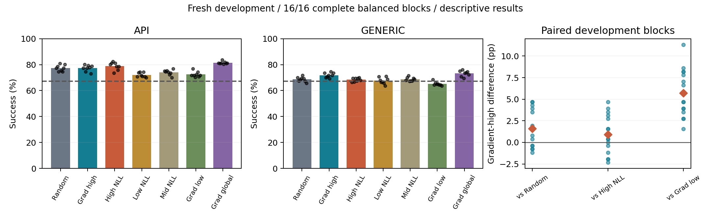
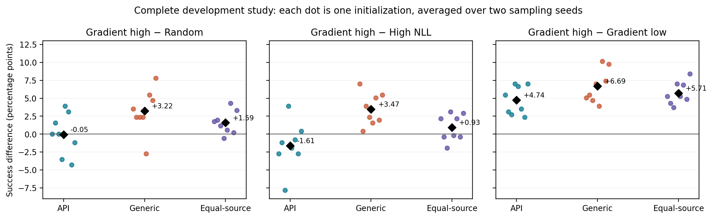

# Imitation Likelihood Is Not Learning Value: A Controlled Study of Agent Experience Selection

Version 0.4, 2026-11-17. This draft reorganizes the paper around the completed fresh-task development study. It preserves earlier drafts. Independent confirmation has not run; no confirmation numbers, calibrated significance claims, or acceptance claims are included.

## Abstract

Successful agent experience can be easy to imitate without being the most useful material for subsequent learning. We study this distinction through supervised fine-tuning of a small language agent, separating experience collection, selection, training, and deployment. Using two fixed historical ALFWorld experience pools, we compare random selection, low/middle/high action negative log-likelihood (NLL), and optimizer-aware gradient selection. Six selectors preserve the reference task/action schedule and distinct-content quotas; an unrestricted global-gradient selector is reported separately. A complete development study trains 224 students across eight initialization seeds and two sampling seeds and evaluates them, together with an untrained base, on 128 fresh development task groups, yielding 28,800 episodes. High-gradient selection exceeds low-gradient selection by 5.71 percentage points on average, with positive differences at all eight initializations. Its advantages over random and high-NLL selection are smaller, 1.59 and 0.93 points, and depend on the source pool. A strict length-matching feasibility analysis substantially reduces the available gradient-score contrast, preventing attribution of the effect uniquely to gradient alignment. These results support a distinction between imitation likelihood and downstream learning utility while identifying limits of both simple likelihood filtering and gradient-based selection. Independent-task confirmation remains pending.

## 1. Introduction

Agent harnesses change what a model encounters, which actions it produces, and whether a collection attempt succeeds. These immediate improvements do not directly determine what a smaller student can learn from the resulting demonstrations. A successful trajectory can contain redundant actions; an action assigned high probability by the current student may provide little new supervision. Conversely, an unfamiliar action can be useful or simply difficult to learn.

We ask a concrete question: when task exposure, action composition, distinct-content support, and sample presentations are held fixed, how does selecting different successful experience affect the trained agent? The question concerns the utility of selected corpora, rather than only their collection success or training loss.

Our study compares likelihood-based filtering with random and optimizer-aware gradient baselines. The gradient score follows existing influence-based instruction-data selection ideas; we do not claim the general scoring algorithm as a new contribution. The contribution is a controlled agent-learning study, including matched interventions, fresh task groups, independent training initializations, strong simple selectors, and explicit limitations on interpretation.

The main finding has two parts. First, high- and low-gradient selections produce different student behavior under the shared coverage and presentation constraints. Second, beating the low-scoring intervention does not imply beating strong simple alternatives: high-gradient selection improves on random and high NLL in the Generic pool, while the API pool exhibits a different ranking. Reporting both findings prevents a selection score's ability to separate outcomes from being mistaken for universal practical superiority.

## 2. Problem and Estimands

Let $D_s$ denote an existing experience pool from collection condition $s$, $S_p$ a selection rule, $A_B$ the fixed SFT procedure under presentation budget $B$, and $H$ the common deployment executor. For initialization/dropout seed $i$ and sampling seed $j$, the trained policy is

$$
\theta_{s,p,i,j}=A_B(\theta_i,S_p(D_s;j)).
$$

For a fixed evaluation panel $Q$, define

$$
R_{s,p,i,j}(Q,H)=\frac{1}{|Q|}\sum_{q\in Q}
\mathbf{1}\{\text{success}(\theta_{s,p,i,j},q,H)\}.
$$

The task families are balanced, so averaging over all 128 tasks equals an equal-family average. Our within-pool contrast is

$$
\Delta_s(p,p')=\frac{1}{IJ}\sum_{i=1}^{I}\sum_{j=1}^{J}
\left[R_{s,p,i,j}(Q,H)-R_{s,p',i,j}(Q,H)\right].
$$

We report both source-specific contrasts and their equal-source average. The sources are two fixed historical pools, not independent sampled harnesses. Each initialization's result first averages its two sampling replicates; 16 sampling blocks are not 16 independent initializations.

These interventions identify the effect of changing the selected corpus under the stated controls. They do not identify a unique causal value for an individual example or prove that a score estimates such a value. Equal presentation counts also do not imply equal token counts or FLOPs.

## 3. Experience Selection and Controls

### 3.1. Pools and student

The historical API and Generic pools contain 721 and 732 action-demonstration rows, with 418 and 508 distinct message contents, respectively. Source labels describe how the pools were collected; they are not randomized treatments. All selection experiments reuse these pools and make zero new teacher calls.

The student is Qwen3-4B-Instruct-2507, fixed at revision `cdbee75f17c01a7cc42f958dc650907174af0554`. Every student starts from the original base model. Gradient-feature warmup weights are not reused as a student's training starting point.

### 3.2. Seven selectors

We evaluate Random, Low NLL, Middle NLL, High NLL, Gradient high, Gradient low, and Gradient global. Likelihood selectors use the canonical, numerically checked action scores. Middle NLL selects content near the within-stratum median; it checks whether the observed likelihood relationship is monotonic.

Gradient features use four FP32 checkpoints and 40 fixed public support actions. The implementation is optimizer-aware and follows existing influence-based data-selection practice, with LESS retained as a reference implementation and attribution. Feature extraction, numerical checks, and warmup costs are recorded. The support actions are not added to any student's SFT corpus.

The first six rules preserve the corresponding Random reference's task/action type at every training position and the stratum-specific distinct-content quotas. Each schedule contains 768 presentations and 256 distinct task-content items. Gradient high and Gradient low reverse the score ordering under the same admissible support constraints.

Gradient global instead selects the top 256 distinct scored contents without matching task/action coverage. It is a strong unrestricted baseline, but its difference from the controlled rules can include coverage effects. We report it rather than omitting a better-scoring method, and do not interpret its entire advantage as content value under matched coverage.

### 3.3. Training and deployment

Training uses BF16 LoRA with rank 16, alpha 32, dropout 0.05, and the attention projections `q_proj`, `k_proj`, `v_proj`, and `o_proj`. Each student receives 192 optimizer updates, batch size four through accumulation, learning rate $10^{-4}$, warmup ratio 0.05, zero weight decay, and maximum sequence length 2,048. Input and target token totals are audited separately.

Deployment uses a common JSON action executor with two fixed public examples, task-local interaction history, no teacher card, no retry, and no cross-task memory. The inherited adapter interface combines the student's A adapter with an audited immutable zero-B branch, without B updates or BF16 weight merging. Evaluation uses environment seed 11, temperature zero, batch size eight, history length 12, at most 40 calls per episode, and at most 128 generated tokens per call.

## 4. Experimental Design

The development matrix crosses two pools, seven selectors, eight initialization/dropout seeds, and two sampling seeds: 224 independently trained students. An untrained base is evaluated on the same panel. Each model uses 128 fresh task groups, with 64 placement and 64 cleaning tasks. Groups are disjoint from historical training, interface-calibration, and reserved confirmation groups. They are derived from the official training split and are not an official seen/unseen benchmark test.

The complete matrix yields 28,800 evaluation episodes. Prespecified interim reports at 1, 2, 4, 8, and 16 complete balanced blocks are retained. The queue did not stop according to the observed effect direction, and incomplete blocks did not enter comparisons. The full development study consumed 62.146 cumulative GPU-hours including its stated preparation costs; historical collection and prior experiments remain separate costs.

An independent audit reconstructs outcomes from raw episodes, events, generation requests, training records, and model identities. All 509 frozen inputs remain unchanged. All 607,700 requests have response records, with no request errors or unknown usage. Final and interim cloud summaries are byte-verified; 224 native training endpoint summaries match local records. These provenance checks establish result integrity, not scientific significance.

## 5. Complete Development Results

The base model succeeds on 67.188% of the same 128 tasks. Earlier 32-task interface-calibration scores are not used as this study's learning baseline.

| Selector | API success | Generic success |
|---|---:|---:|
| Random | 77.344% | 68.652% |
| Gradient high | 77.295% | 71.875% |
| High NLL | 78.906% | 68.408% |
| Low NLL | 72.070% | 67.627% |
| Middle NLL | 73.975% | 68.750% |
| Gradient low | 72.559% | 65.186% |
| Gradient global | 81.445% | 73.193% |

### 5.1. Separating high- and low-scoring experience

Gradient high exceeds Gradient low by 4.736 points in API and 6.689 points in Generic, or 5.713 points under equal-source averaging. All eight initialization-level equal-source differences are positive, ranging from 3.711 to 8.398 points. All 16 paired sampling-block differences are also positive; this is a second description of the same crossed experiment, not 16 additional independent replicates.

### 5.2. Strong baselines and source dependence

Relative to Random, Gradient high differs by −0.049 points in API and +3.223 points in Generic. Relative to High NLL, the differences are −1.611 and +3.467 points. The equal-source advantages are 1.587 and 0.928 points. Seven of eight equal-source initialization contrasts favor Gradient high over Random; the comparison with High NLL is split four positive and four negative.

Thus the evidence for separating high- and low-scoring selections is stronger than the evidence for consistently improving on simple alternative selectors. High NLL is the best controlled selector in API, whereas Gradient high is the best controlled selector in Generic. The unrestricted global-gradient rule is highest in both pools, but changes coverage.

### 5.3. Likelihood is not a sufficient selection objective

In API, Low, Middle, and High NLL obtain 72.070%, 73.975%, and 78.906%; Low NLL is below Random. Generic shows a smaller and nonmonotonic likelihood ordering, with 67.627%, 68.750%, and 68.408%, respectively. These source-dependent results do not support selecting the easiest-to-imitate examples as a generally reliable downstream-learning criterion. They also do not establish that high NLL is universally optimal.

### 5.4. Independent confirmation

**Pending, not a result.** The bounded finishing plan retains Random, High NLL, Gradient high, and Gradient low from both pools at all eight initializations and both sampling seeds. Reusing existing checkpoints on 128 reserved task groups would require 16,512 episodes including the base. The final inference, resource cap, execution freeze, and analysis must be fixed before any confirmation model call. This section will contain a complete development/confirmation comparison, including adverse outcomes, after the one planned confirmation phase.

## 6. What the Controls Do Not Identify

### 6.1. Length and admissible support

Despite equal presentations, Gradient high uses fewer input tokens than Gradient low: 476,314 versus 500,016 on average in API, and 510,404 versus 527,626 in Generic. Length can covary with state redundancy, action details, and difficulty, so the observed intervention is not uniquely attributable to gradient alignment.

A CPU-only feasibility analysis fixed exact target-token matching and input-length bin widths of 0, 8, 16, and 32 tokens before observing any length-matched student's result. It required at most 1% total input-token imbalance across four selectors and retention of at least 25% of the original gradient-score contrast in every source/sampling condition. No width passed. At width 32, API retained 3.45% and 5.23% of its original contrast, and Generic retained 18.17% and 17.06%. Exact input-length matching left no API contrast and approximately 2.5–3.0% in Generic.

We therefore do not train near-identical matched selections merely to label them a mechanism test. The feasibility result shows limited conditional choice in these pools; it does not show that length explains the downstream effect. Identifying gradient information beyond length requires additional admissible support and remains outside this paper's completed claims.

### 6.2. Historical controls and retained negative evidence

Earlier studies progressively matched task and action exposure and repeated the low-NLL comparison under canonical scoring. The completed canonical replication observed Low NLL−Random differences of −3.516 points in API and −3.060 in Generic. These studies use repeatedly inspected earlier task panels and are reported as historical controlled evidence, not interchangeable fresh-test replications.

The separate API-versus-ReAct source comparison is also retained: its raw adaptation-AUC difference is −3.56 points across three seeds after common-success matching. The new within-pool selection study does not resolve the missing sufficiently consumed full-eligible source comparison or establish that API collection produces a better learner.

## 7. Discussion and Scope

The supported development conclusion is that imitation likelihood and downstream corpus utility differ, and that a gradient-based selection intervention can separate student outcomes under meaningful but incomplete controls. Practical superiority depends on the pool and comparator. A high-versus-low score intervention is insufficient to establish a generally best selection algorithm, a unique optimization mechanism, or a calibrated corpus-value predictor.

The study uses one backbone, one text environment, and two fixed historical pools. Repeated schedules overlap, and 224 training runs are not 224 independent corpora. Neither robot manipulation nor VLA evaluation has been performed. Earlier WebShop episodes establish interface calibration only; they are not a second-environment learning replication. Official benchmark evaluation remains sealed. Independent-task confirmation is the final planned empirical addition for this draft, rather than a claim already supported here.

We report development point estimates and initialization-level dispersion without uncalibrated significance or equivalence claims. Confirmation will retain all selectors and sources required by its frozen protocol. A null or reversed confirmation result will narrow the conclusion rather than trigger an unreported search for a different winning task family or seed subset.

## References and Reproducibility Notes

Existing verified bibliographic entries are retained in `docs/paper/latex/references.bib`, including ALFWorld, ReAct, LoRA, the Qwen3 report, and LESS. Optimizer-aware scoring is attributed to the existing selection literature; no novelty-priority claim is made in this draft. The final related-work audit must check directly related agent-data selection work before submission.

The development source protocol, all intermediate reports, final aggregate, local/cloud audits, numerical scoring checks, and post-development analysis remain versioned separately. Raw task identities, messages, request journals, and weights remain local. This draft's pending section is not evidence and must not be converted to a completed claim before its actual run.
