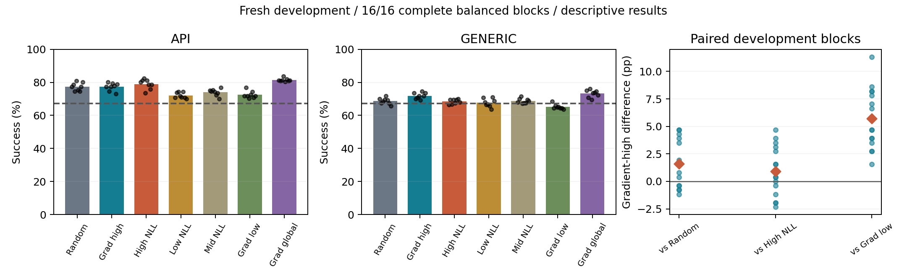

# 新任务经验学习价值：开发结果

固定16块中的16个完整均衡块，224个学生、28800回合。基础模型成功率67.188%。

这是开发研究；不报告未经二值结果校准的p值、少种子bootstrap区间或等效结论。点估计、逐初始化/采样块及所有负向结果保留。

| 方法 | API成功率 | Generic成功率 |
|---|---:|---:|
| random | 77.344% | 68.652% |
| gradient_high | 77.295% | 71.875% |
| high | 78.906% | 68.408% |
| low | 72.070% | 67.627% |
| middle | 73.975% | 68.750% |
| gradient_low | 72.559% | 65.186% |
| gradient_global | 81.445% | 73.193% |

Grad global未控制覆盖，其他条件保持逐位置任务/动作与不同内容配额。全部条件同呈现预算，实际token与准备成本另计；没有开启确认集或官方测试。
