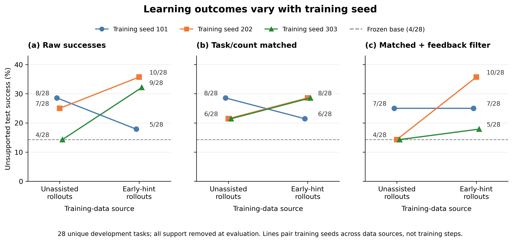
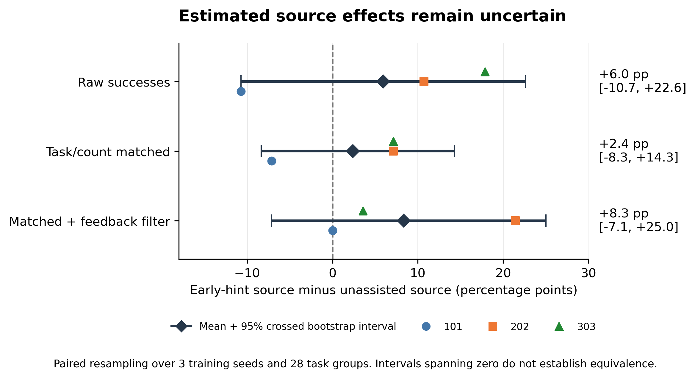
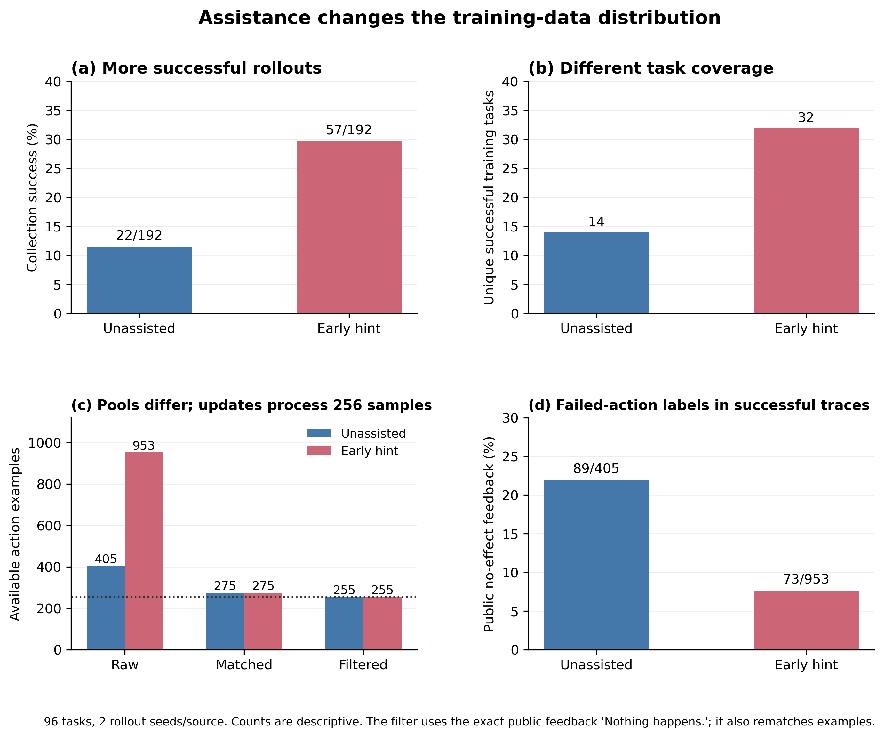
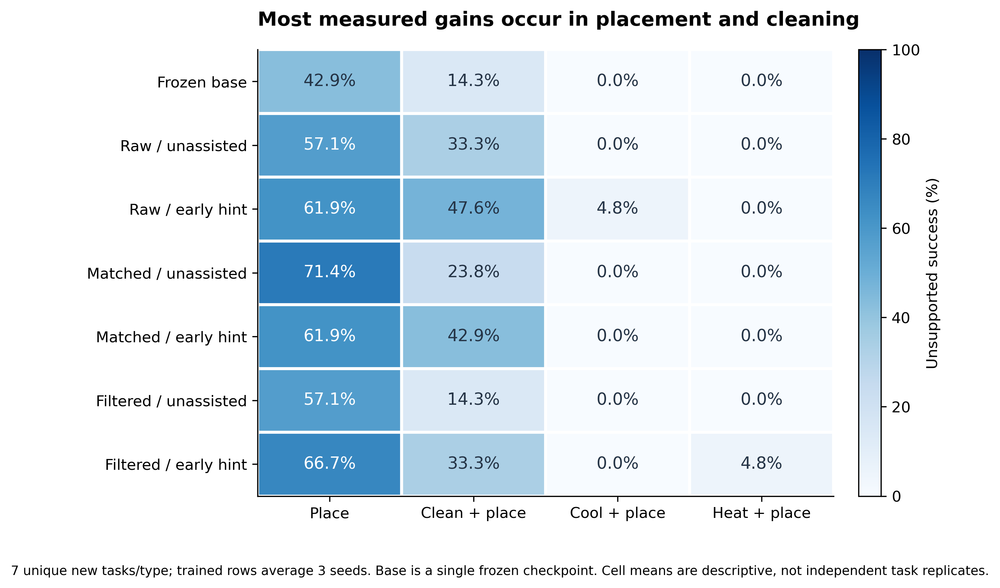
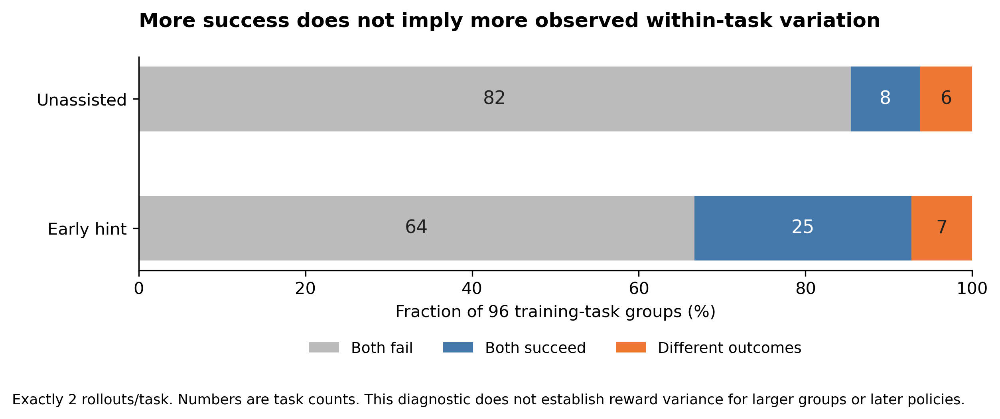
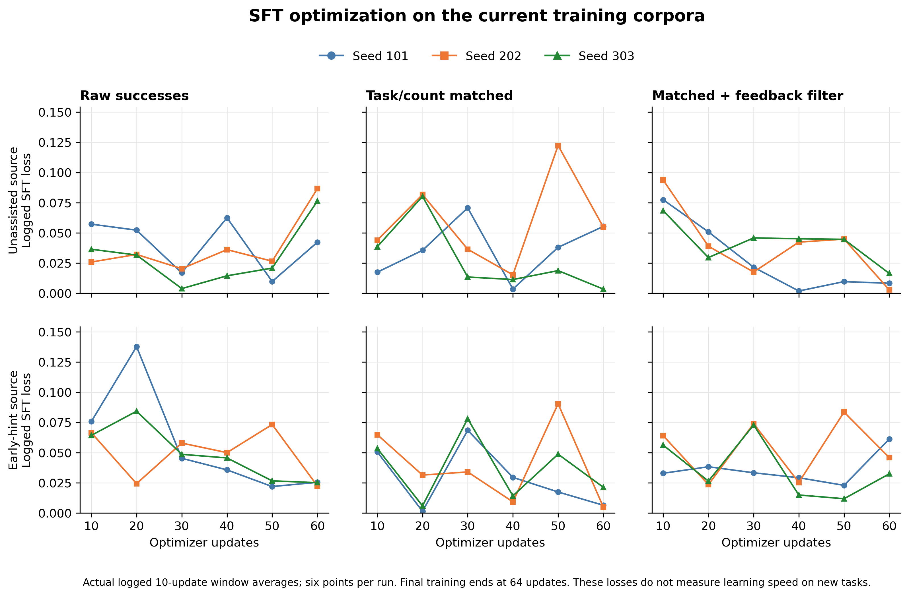

# Harness 第二轮：实测图与论文图注

所有图均由真实日志生成，主评测集为 28 个此前未评测的开发任务。每个训练条件有 3 个训练种子，全部评测撤掉支持。每个模型实际处理 256 条示范，完成 64 次 LoRA 更新。官方 seen/unseen 最终测试保持留出。

每张图提供 PNG、可编辑 SVG、矢量 PDF；同目录 CSV 和 `plot-data.json` 是对应数值。英文标签便于论文使用，下面给出中文解释和英文图注草稿。

## 图 1：逐种子配对



**说明：** 同一条线连接同一训练种子下的两个训练数据来源，不是训练过程中的学习曲线。原始和匹配条件都只有 seed 101 出现负向排序；过滤后这次没有负向排序。不能只选 seed 101 写“更强 harness 培养更差学习者”。

**Caption draft.** Unsupported evaluation after 64 LoRA updates on 28 development tasks. Each line pairs the same training seed across rollout-data sources. Panels compare raw successful trajectories, task/count-matched trajectories, and matching after public no-effect-feedback filtering. The dashed line denotes the frozen base model. Lines are paired endpoint comparisons, not optimization trajectories.

## 图 2：来源效应及不确定性



**说明：** 正值表示早期支持来源训练后更好，负值才与其即时优势相反。三个区间均跨零；这既不支持稳定排序反转，也不证明两种来源等效。只有三个训练种子，区间精度有限。

**Caption draft.** Source effects on unsupported success. Diamonds denote mean paired effects, colored markers denote individual training-seed effects, and whiskers denote percentile intervals from crossed paired resampling over training seeds and task groups. Positive effects favor early-hint-generated data. All intervals include zero; this should not be interpreted as evidence of equivalence.

## 图 3：采集改变了什么



**说明：** 早期支持提高采集成功数，也改变成功任务覆盖、示范池数量及公开无效反馈比例。匹配选择共同成功子集，过滤还会改变示范分布，所以不能把残余来源差距简单归因于“学习者能力”。柱上给出实际分子/分母；它们是描述性统计，不假设所有重复 rollout 独立。

**Caption draft.** Assistance changes the training-data distribution. Collection uses 96 tasks and two rollout seeds per source. Panels show successful episodes, unique successful tasks, available action-example pools, and the fraction of public no-effect feedback in successful trajectories. Every trained model processes 256 examples regardless of pool size. The feedback filter uses the exact observation `Nothing happens.` and subsequently rematches examples.

## 图 4：任务类型分解



**说明：** 每列只有 7 个唯一任务；训练行是三个种子的平均。放置、清洗贡献了主要学习信号，冷却/加热接近地板。总分难以告诉我们复杂技能究竟有没有学会。下一阶段先做可学习性正控制，再比较学习速度。

**Caption draft.** Task-type decomposition of unsupported evaluation. Each column contains seven unique development tasks. Trained rows average three training seeds; the base row is a single frozen checkpoint. Gains are concentrated in placement and cleaning, while cooling and heating remain near the observed success floor. Cell means are descriptive and repeated seeds do not create additional independent tasks.

## 图 5：RL 前置奖励组诊断



**说明：** 两次采样下，有组内奖励差异的任务仅为 6/96 与 7/96。若只用这两个二值回报构成 `A_i = r_i - mean(r_group)`，其余组的优势为零。这不是已经运行了 RL，也不能推断更大组或训练后策略的奖励方差。

**Caption draft.** Binary reward patterns for two sampled rollouts per training task. Numbers denote task-group counts. Early hints increase successful rollouts, while the number of observed non-flat groups changes from six to seven. This two-sample diagnostic does not establish reward variance for larger groups or future policies and does not constitute an RL training result.

## 图 6：实际训练 loss 诊断



**说明：** 来自每个 run 的真实训练日志，按固定日志间隔标出第 10/20/30/40/50/60 次更新的窗口平均 loss，不绘制不存在的第 0 或第 64 次瞬时 loss。不同数据池的 loss 对象不同，不能拿低 loss 当成更强泛化或更快学习新任务的证据。

**Caption draft.** Logged optimization diagnostics for the current SFT corpora. Curves show the six actual ten-update-window loss entries at updates 10 through 60; each run ends at update 64. No unlogged loss values are interpolated as observations. Training loss on these corpora is not a measure of adaptation speed on new tasks.

## 当前能怎么写文章

可以写实验设置、预算控制、数据选择诊断和不确定性分析。可复述的探索性观察是：在当前 4B 模型、通用策略提示与短 SFT 预算下，采集成功率提升并未给出稳定的即时/学习排序冲突。

不能将当前结果写成已经证实“更强 harness 让模型更不会学习”，不能声称过滤机制已被确认，也不能把这些配对线或训练 loss 改称新任务适应曲线。当前图更适合预实验和控制分析；它们单独不足以构成论文的核心贡献。

论文主实验需要新任务适应曲线、初始能力及旧能力保持的对照。新阶段设计见项目 `docs/LEARNING_SPEED_NEXT_PHASE.zh-CN.md`。目前尚无这些曲线，不能补画假结果。

## 复现

工作区内从原始结果核验并绘图：

```bash
python3 scripts/plot_study.py
```

图包内不需要模型、GPU 或完整轨迹日志，可从数值导出重绘：

```bash
python3 source/render_exported_figures.py --data plot-data.json --out regenerated
```

依赖和输入 SHA-256 见 `figure-manifest.json`。绘图源代码随图包提供。这里的区间和种子数不支持等效性检验或跨模型规律的结论。
