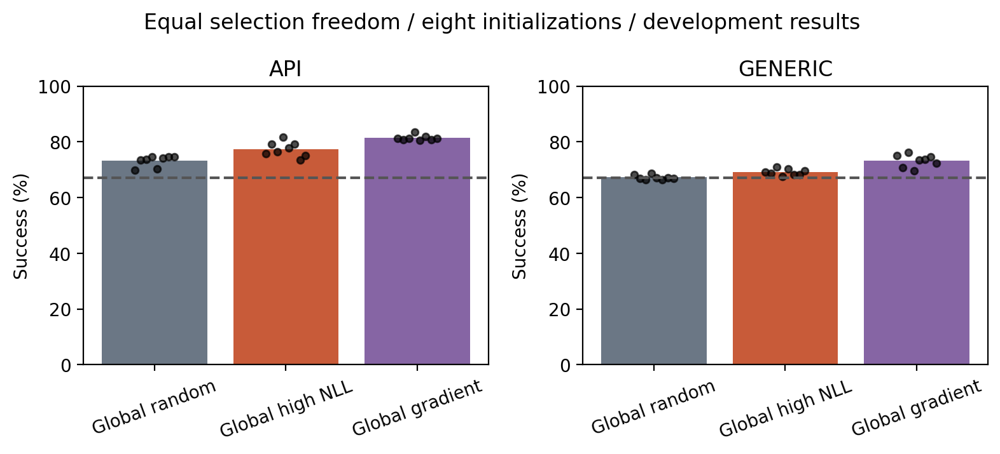

# 全局选样：同等选择自由度的开发对照

64个新增学生，复用32个全局梯度学生及基础模型。八初始化、两采样；无确认集结果。

| 规则 | API成功率 | Generic成功率 |
|---|---:|---:|
| global_random | 73.193% | 67.236% |
| global_high | 77.344% | 69.141% |
| gradient_global | 81.445% | 73.193% |

同呈现预算和选择自由度，实际token与评分成本另计；不作未经校准的确认性检验。

