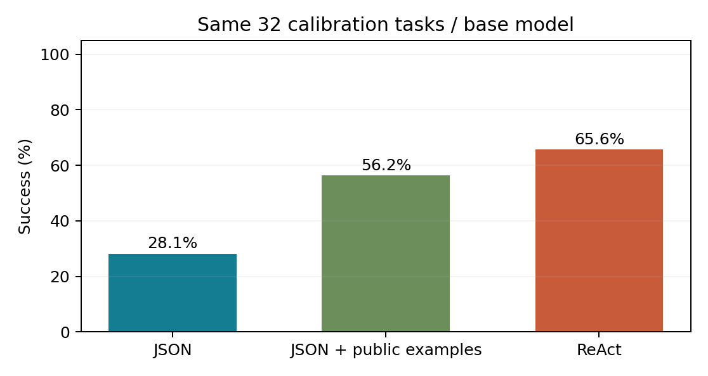

# JSON兼容公共示例校准

新增32回合，开发/确认集仍未评测。前轮JSON/ReAct作为同任务历史校准坐标；没有最终学生训练收益结论。

| 条件 | 成功/32 | 请求数 |
|---|---:|---:|
| json_direct | 9/32 | 1098 |
| react_retry | 21/32 | 703 |
| json_public_examples | 18/32 | 748 |

保持JSON指令和解析，只增加公共示例，便于后续JSON动作监督学生采用共同部署接口。与ReAct的比较还涉及思考与格式差异，不是单因素机制实验。

