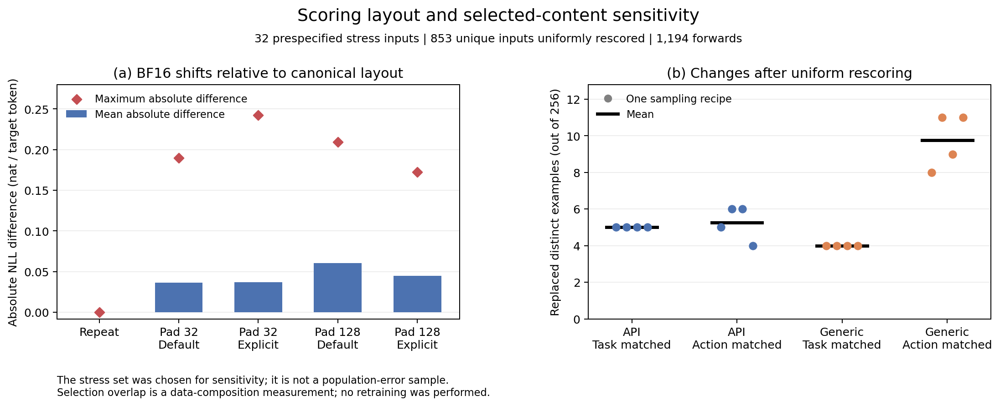

# 独立 NLL 评分诊断：完整结果

冻结基础学生、853个不同train输入；32个预先指定压力输入包含16个缓存分差较大输入及16个按SHA选出的输入。压力集用于定位数值敏感性，不代表总体误差分布。

执行完成：**1,194次forward、853/853统一评分、107.127 GPU秒**，无错误或未知请求用量。原始模型文件前后核验通过；教师调用、环境回合、优化更新与正式测试均为0。

重复canonical评分最大分差0；4次FP32窗口评分与HF完整labels loss的最大差为3.5315752e-06 nat/token，均通过冻结门槛。原批布局392个观测与旧缓存完全复现，最大绝对差0。BF16与FP32压力输入的平均/最大绝对差为0.039611/0.163044 nat/token。

## 布局敏感性

| 左padding / position IDs | 平均绝对分差 | 最大绝对分差 | 与canonical的rank相关 |
|---|---:|---:|---:|
| 32 / default | 0.036219 | 0.189947 | 0.983138 |
| 32 / explicit | 0.037077 | 0.242403 | 0.984971 |
| 128 / default | 0.060323 | 0.209602 | 0.985337 |
| 128 / explicit | 0.044633 | 0.172667 | 0.982405 |

无padding时，默认position IDs及动态logits窗口均与canonical相同。显式position IDs仍出现padding关联分差，因此当前结果不将其统一归因为position IDs错误。这里报告观测分差与相关，不输出未经校准的总体推断。

## 统一评分后的选择名单

原16份低NLL配方先用旧缓存精确再生，再以统一分数比较；不同内容预算、任务/动作配额和原始数据保持一致。

| 来源 | 阶段 | 采样配方 | 替换内容数 | 原内容保留率 |
|---|---|---:|---:|---:|
| api | stage3 | 101 | 5/256 | 98.047% |
| api | stage3 | 202 | 5/256 | 98.047% |
| api | stage3 | 303 | 5/256 | 98.047% |
| api | stage3 | 404 | 5/256 | 98.047% |
| api | stage4 | 101 | 5/256 | 98.047% |
| api | stage4 | 202 | 6/256 | 97.656% |
| api | stage4 | 303 | 6/256 | 97.656% |
| api | stage4 | 404 | 4/256 | 98.438% |
| generic | stage3 | 101 | 4/256 | 98.438% |
| generic | stage3 | 202 | 4/256 | 98.438% |
| generic | stage3 | 303 | 4/256 | 98.438% |
| generic | stage3 | 404 | 4/256 | 98.438% |
| generic | stage4 | 101 | 8/256 | 96.875% |
| generic | stage4 | 202 | 11/256 | 95.703% |
| generic | stage4 | 303 | 9/256 | 96.484% |
| generic | stage4 | 404 | 11/256 | 95.703% |

保留率为95.703%–98.438%，最多替换11/256条不同内容。此处是统一评分与原缓存的比较，区别于先前首/末缓存副本敏感性核对；旧缓存与原配方均保留。**没有按新名单重训模型，名单变化不能直接换算为策略成功率变化。**

[PDF](../pdf/nll-scoring-diagnostic-v1/scoring-layout-and-selection.pdf) · [原汇总](aggregate-summary.json) · [独立日志复核](../research-operations/20261113/nll-scoring-complete-local-check.json) · [绘图代码](../../scripts/plot_completed_followups.py)
