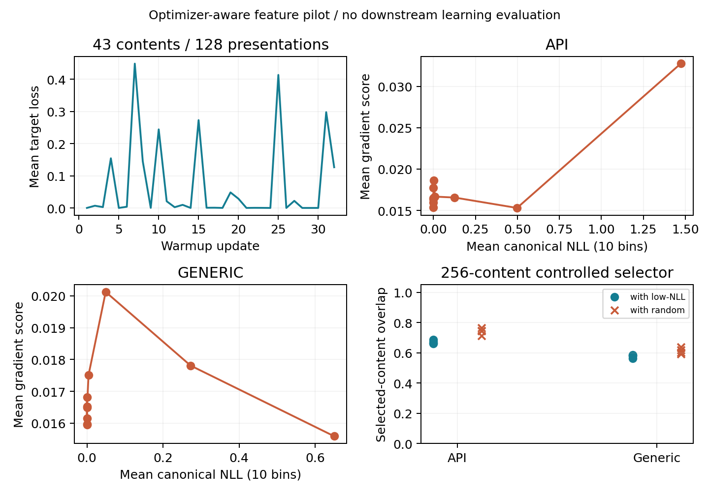

# 优化器感知梯度选样：实现试验结果

完成32次预热更新、4个检查点、853个不同候选和40个公开支持动作；总3708次forward/backward。没有训练最终学生，也没有新任务成功率。

| 来源 | 不同内容 | 分数标准差 | 与NLL的Pearson相关 |
|---|---:|---:|---:|
| api | 418 | 0.010107 | 0.46168853856672054 |
| generic | 508 | 0.008326 | 0.008796238941895887 |

已准备8份任务/动作/内容预算匹配清单和8份全局top256清单，均未训练。分数与NLL相关或不同都不等于预测真实收益，下一步需要同预算学习对照。

