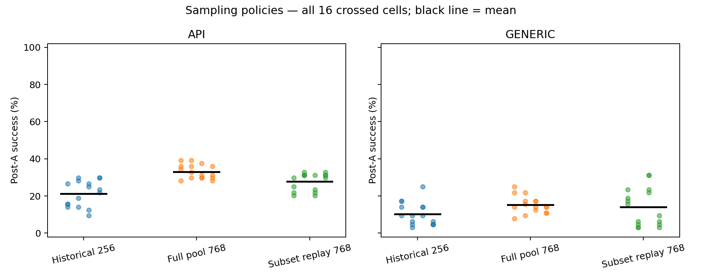
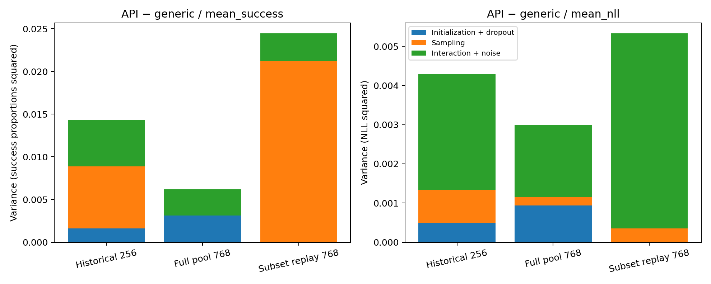
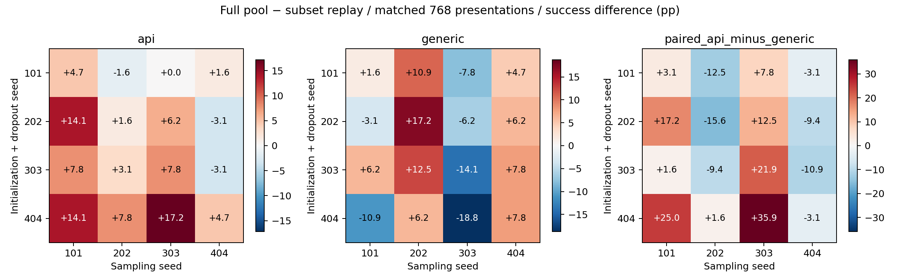

# Stage 2：同预算采样干预

68个新模型、4,352个新任务回合已完成。两个新组均192次更新、768次呈现。

| 新组 | API−generic平均成功率差（pp） | 抽样方差 | 抽样占比 |
|---|---:|---:|---:|
| full_pass | 17.773 | 0 | 0.0 |
| subset_replay | 13.867 | 0.0211995 | 0.8661679135494597 |

同预算full_pass−subset_replay平均成功率差：
- api: +5.176 pp
- generic: +1.270 pp
- paired_api_minus_generic: +3.906 pp

三组逐单元、NLL、实际覆盖/token、原始分量、留一敏感性范围和条件训练重复见summary.json与CSV。
留一范围不是置信区间。采样策略同时改变示范覆盖、频率和顺序；历史256组同时改变优化剂量和学习率调度长度。

