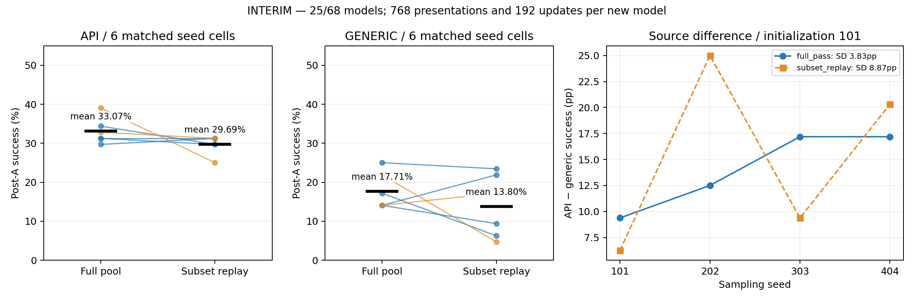

# Stage 2中途快照

2026-11-12T16:03:54.152135+08:00

已完成25/68个模型，其中24个模型构成6组完整配对单元。所有已完成记录均保存在inputs.json；未配齐单元不参与均值比较。

两个新组均192次更新、768次示范呈现；同单元使用相同GPU。每个模型评测同一套64个开发任务。

| 来源 | 全池遍历成功率 | 子集复用成功率 | 配对差值 | 胜/平/负 |
|---|---:|---:|---:|---:|
| api | 33.07% | 29.69% | +3.39pp | 4/1/1 |
| generic | 17.71% | 13.80% | +3.91pp | 4/0/2 |

| 初始化 | 已完成的采样种子数 | 全池来源差SD | 子集来源差SD |
|---|---:|---:|---:|
| 101 | 4 | 3.83pp | 8.87pp |
| 202 | 2 | 9.94pp | 13.26pp |

这里的SD只描述同一初始化下API−generic差值随采样种子的变化，不是完整4×4的总体方差分解。两来源平均收益和NLL、任务类型与token暴露均保留在summary.json。

这是用户要求的中途查看；没有新增检验、改变预算、删选模型或启动额外GPU实验。余下初始化继续用于检验当前趋势的稳定性。

