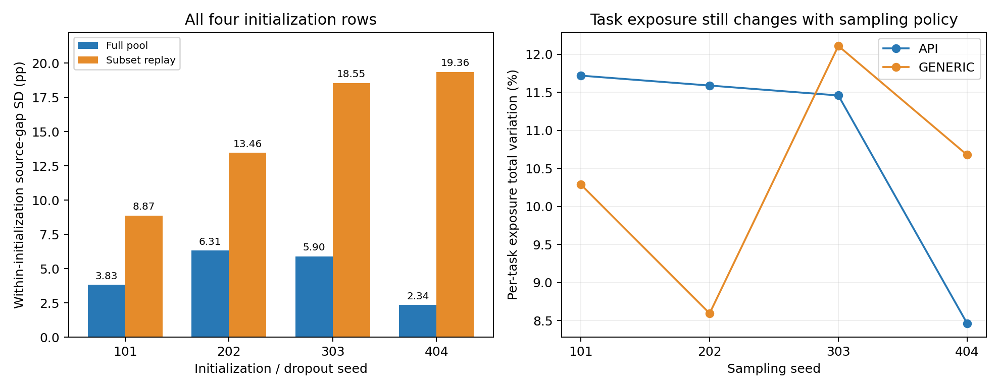

# Stage 2完整结果与机制对照准备

主比较68个模型、4,352个任务回合完成。

| 来源 | 全池相对子集复用成功率变化 | 胜/平/负（16格） |
|---|---:|---:|
| api | +5.176pp | 12/1/3 |
| generic | +1.270pp | 10/0/6 |

下一步控制已固定：逐位置匹配原全池调度的任务ID，逐任务次数完全一致；比较随机选取256条与基础模型低NLL选取256条。新模型仍768次呈现、192次更新。
低NLL选择在同一来源中固定示范成员；其采样种子主要改变顺序，不能将较小波动单独解释为样本质量优势。两组平均任务表现和NLL需同时报告。

准备好的调度配方：16/16。主实验和旧冻结文件未修改。

