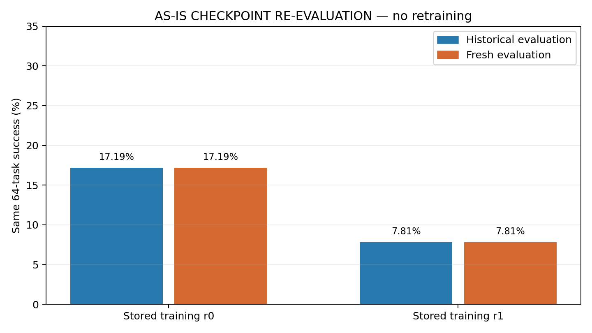

# Stage 3固定检查点复测：完整结果

两个观察后选取的低NLL模型各在原64个开发任务上重评一次，共128个新回合、0.203累计GPU小时；没有重训、教师调用或正式测试。

| 存储的训练重复 | 原成功率 | 复测成功率 | 逐任务成败差异 | 步数差异 |
|---|---:|---:|---:|---:|
| r0 | 17.1875% | 17.1875% | 0/64 | 0/64 |
| r1 | 7.8125% | 7.8125% | 0/64 | 0/64 |

检查点、组成、JSON内核、任务顺序、环境种子11、温度0和batch 8均保持一致，权重前后哈希不变。这两个检查点的成败与步数复测完全一致，支持此前条件重训差异来自训练后参数变化的解释。没有断言生成token逐位一致、所有模型推理噪声为零或已估计总体噪声比例。

原Stage 3的70模型/4480回合、四初始化主均值与条件重复均保留，新128回合不混入原分析。

