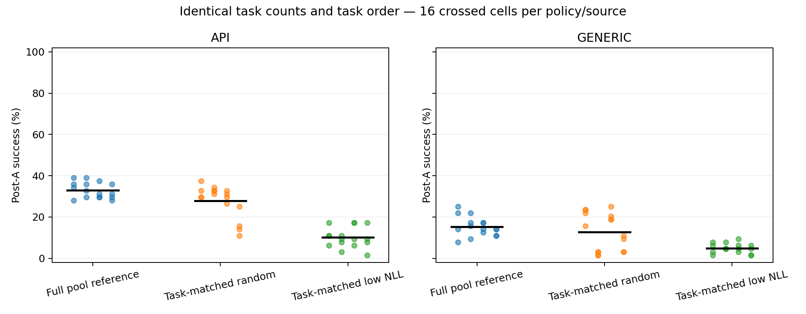
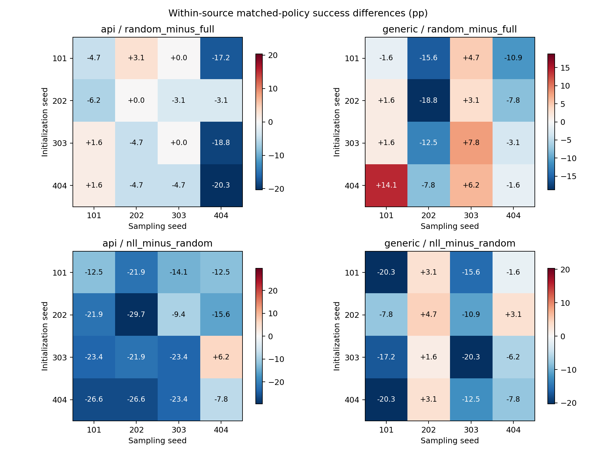

# Stage 3：逐任务匹配后的经验选择

70个新模型、4,480个新评测回合完成。参考全池使用Stage 2的34个已完成模型，另有2次本轮全池检查。

| 对比 | 来源 | 成功率平均差 |
|---|---|---:|
| random_minus_full | api | -5.078pp |
| random_minus_full | generic | -2.539pp |
| nll_minus_random | api | -17.773pp |
| nll_minus_random | generic | -7.812pp |
| nll_minus_full | api | -22.852pp |
| nll_minus_full | generic | -10.352pp |

各单元、NLL、实际token与任务暴露、原始分量和留一敏感性范围见JSON/CSV；范围不是置信区间。

