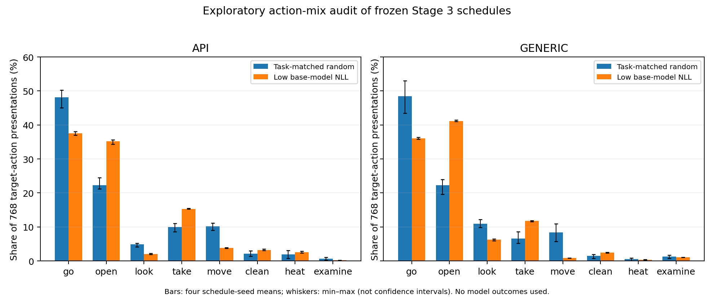

# Stage 3动作构成探索性审计

在看到首组中途结果之后定义，只分析既定16份调度，不修改训练、不选择评测结果。

| 来源 | 随机选择move呈现占比 | 低NLL选择move呈现占比 |
|---|---:|---:|
| api | 10.19% | 3.84% |
| generic | 8.43% | 0.91% |

move是规范化放置动作。两策略匹配任务ID、次数和顺序，但动作类型构成仍会变化。较少放置示范是值得后续干预验证的解释，当前不能据此断言它导致表现差异；动作多样性、上下文与选择难度仍会同时变化。

每种来源每种策略汇总4个调度种子。图中误差线为最小值至最大值，非置信区间。目标/输入token量单列于CSV与JSON，不宣称精确FLOP匹配。

