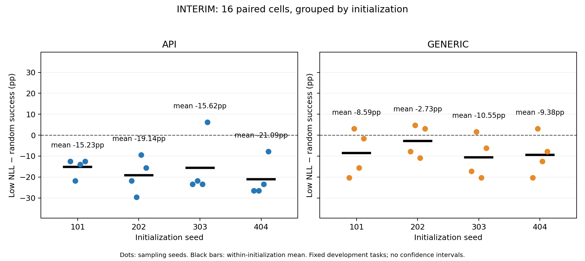

# 中途结果：按初始化分解

| 来源 | 初始化 | 采样种子数 | 低NLL−随机平均差 | 胜/平/负 |
|---|---:|---:|---:|---:|
| api | 101 | 4 | -15.23pp | 0/0/4 |
| api | 202 | 4 | -19.14pp | 0/0/4 |
| api | 303 | 4 | -15.62pp | 1/0/3 |
| api | 404 | 4 | -21.09pp | 0/0/4 |
| generic | 101 | 4 | -8.59pp | 1/0/3 |
| generic | 202 | 4 | -2.73pp | 2/0/2 |
| generic | 303 | 4 | -10.55pp | 1/0/3 |
| generic | 404 | 4 | -9.38pp | 1/0/3 |

保留每个配对采样单元；这是同一开发任务集上的描述性分解，未新增检验或改变预算。

