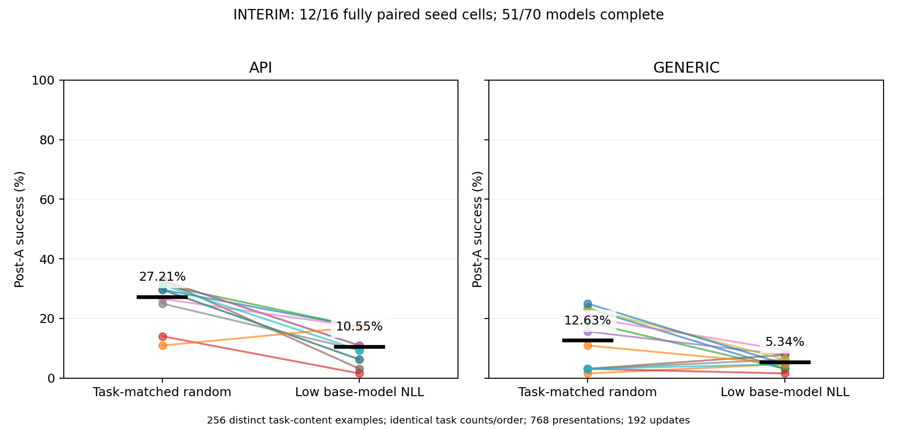

# Stage 3中途成对观察

完成51/70个模型；均值只使用12组两来源、两策略均完成的种子单元。

| 来源 | 随机选择成功率 | 低NLL成功率 | 低NLL−随机 |
|---|---:|---:|---:|
| api | 27.21% | 10.55% | -16.67pp |
| generic | 12.63% | 5.34% | -7.29pp |

这是描述性中途观察，无显著性检验或提前停止规则。未配齐单元、参考检查和条件重复保留于inputs.json，均不混入成对均值。原正式方案、预算和评测任务不变。

