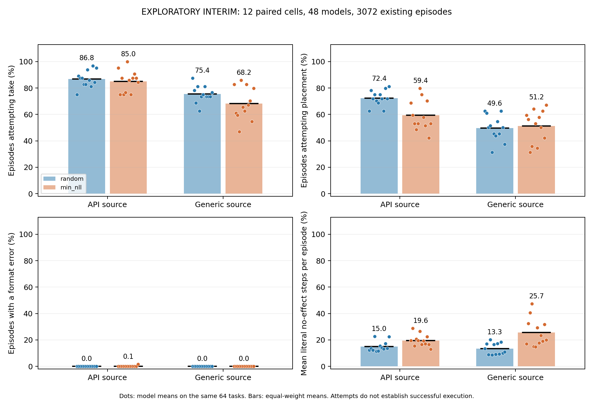

# Stage 3 已有轨迹行为诊断

事后描述性分析：固定于原12单元快照，48个模型、3072个已完成回合。无新增模型调用或训练。

| 来源/策略 | 成功率 | 尝试take回合 | 尝试move回合 | 有格式错误回合 | 回合内无效果反馈占比均值 |
|---|---:|---:|---:|---:|---:|
| api/random | 27.21% | 86.85% | 72.40% | 0.00% | 14.98% |
| api/min_nll | 10.55% | 85.03% | 59.38% | 0.13% | 19.61% |
| generic/random | 12.63% | 75.39% | 49.61% | 0.00% | 13.31% |
| generic/min_nll | 5.34% | 68.23% | 51.17% | 0.00% | 25.71% |

take/move统计尝试动作，不验证物体实际获取或放置。invalid_action字段只标记JSON/action解析错误；Nothing happens.是独立的字面环境反馈代理。无效果占比先在每回合归一化，再跨回合/模型平均，避免长失败轨迹支配统计。

行为与成功率来自相同轨迹，不能据此认定训练动作分布造成成功率差异。动作类型匹配训练仍是独立待检验干预。这里共3个初始化，不把12个采样配对单元当作独立初始化。完整数值、模型点、回合与原始文件哈希见JSON/CSV。

