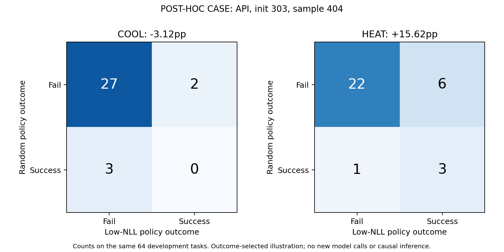

# 事后选取的成对单元：逐任务成功交叉表

api，初始化303，采样404。该单元在观察结果后选取，仅作反例说明。

| 任务族 | 均失败 | 仅随机成功 | 仅低NLL成功 | 均成功 | 低NLL−随机 |
|---|---:|---:|---:|---:|---:|
| cool | 27 | 3 | 2 | 0 | -3.12pp |
| heat | 22 | 1 | 6 | 3 | +15.62pp |
| all | 49 | 4 | 8 | 3 | +6.25pp |

动作尝试、字面无效果反馈和命令重复均来自同批评测轨迹，不能据此归因或作为独立成功预测器。原始回合保留于本地；本报告只含汇总计数。

