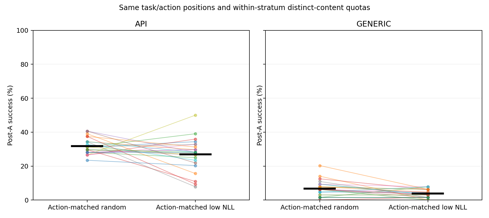

# 任务与动作构成匹配：完整结果

完成100个模型、6400个评测回合，逐任务原始成败与检查点、调度和诊断核对一致。

| 来源 | 低NLL−随机成功率 | 胜/平/负 |
|---|---:|---:|
| api | -4.818pp | 8/1/15 |
| generic | -2.995pp | 3/6/15 |

条件重复分列；均值仅使用repeat=0的成对单元。固定开发任务上的描述性结果，不提供未经校准的置信区间。

