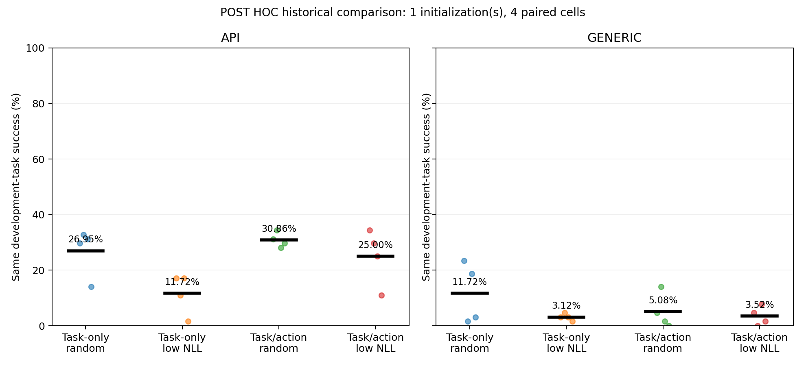

# 动作匹配：固定历史参照的补充审计

看到generic随机组较低后增加的事后描述性审计。固定于预设node-04快照：初始化101、4个采样配方，16个当前模型。原主要对比与100模型队列不变。

| 来源 | 旧任务匹配随机 | 旧任务匹配低NLL | 新动作匹配随机 | 新动作匹配低NLL |
|---|---:|---:|---:|---:|
| api | 26.953% | 11.719% | 30.859% | 25.000% |
| generic | 11.719% | 3.125% | 5.078% | 3.516% |

| 来源 | 低NLL组变化 | 随机组变化 | 策略差值变化 | 新低NLL−固定旧随机 |
|---|---:|---:|---:|---:|
| api | +13.281pp | +3.906pp | +9.375pp | -1.953pp |
| generic | +0.391pp | -6.641pp | +7.031pp | -8.203pp |

API的差距缩小同时伴随低NLL组明显提高和随机组提高；generic的差距缩小主要伴随随机组降低，低NLL组仅小幅变化。这两种来源模式不能合并解释为统一的能力改善。

逐案例已核对相同初始参数、训练器、优化配置、源数据SHA、768次呈现与物理GPU。新动作匹配调度确实以相应旧随机调度为参照。实际内容支持、动作组成约束和NLL选择强度仍随干预改变；token量不被当作相等。

旧参照来自历史轮次；这是单初始化、固定开发任务上的跨轮观察，不是新同轮随机化或因果中介估计。旧随机组本来就提供动作匹配配额，保留它能帮助识别新随机抽取内容带来的变化。当前主要比较仍是各来源内新低NLL−新随机，不替换。

