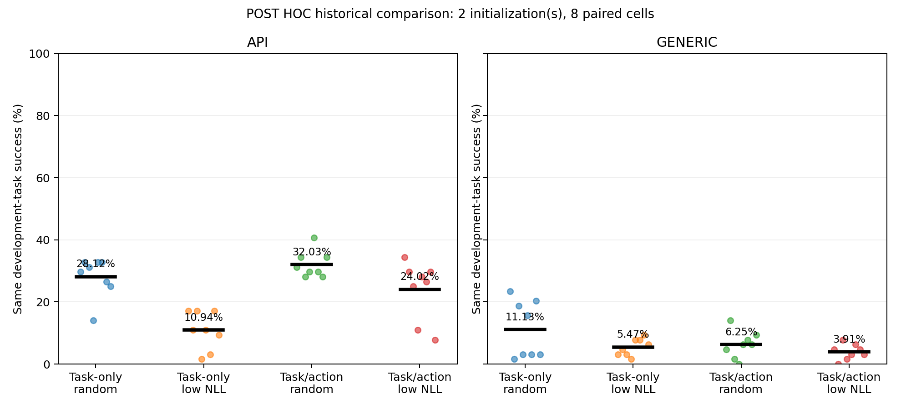

# 两初始化的历史参照与绝对成功率

事后描述性补充，复用预设node-08快照及Stage 3中相同初始化101/202、相同四份采样配方的结果。新旧各32个模型记录；新快照创建时全队列完成33个，多出的未配对模型不进入此比较。这里是2个初始化×4个采样配方，不是8个独立初始化。新增模型调用、环境回合和教师调用均为0。

| 来源 | 旧任务匹配随机 | 旧任务匹配低NLL | 新任务×动作匹配随机 | 新任务×动作匹配低NLL |
|---|---:|---:|---:|---:|
| API | 28.125% | 10.938% | 32.031% | 24.023% |
| Generic | 11.133% | 5.469% | 6.250% | 3.906% |

| 来源 | 随机组变化 | 低NLL组变化 | 低NLL−随机的差值变化 | 新低NLL−固定旧随机 |
|---|---:|---:|---:|---:|
| API | +3.906pp | +13.086pp | +9.180pp | −4.102pp |
| Generic | −4.883pp | −1.563pp | +3.320pp | −7.227pp |

API的差值缩小伴随两组绝对分数提高，低NLL组提高更多；Generic的差值缩小则伴随两组分数降低，随机组降低更多。后者在node-04单初始化时低NLL仅小幅提高，加入第二初始化后均值转为下降，因此不把旧单初始化观察外推成稳定的绝对改善。

这保留了一条有区分力的来源异质性线索：同样的差值缩小可以对应不同的绝对表现变化。当前主要比较仍为新研究内低NLL−新随机，分别−8.008pp、−2.344pp，不改用更有利的历史参照。

32个新模型的worker记录均匹配原不可变快照哈希；与旧结果逐例核对相同初始参数、训练器、优化器配置、源数据、768次呈现及物理GPU，并确认新动作配额源于对应的旧随机调度。输入内容支持、NLL选择强度和token量随干预改变；历史轮次间的训练数值差异也未单独消除，不能据此识别纯动作构成的因果中介效应。

这是看到node-04结果后增加的历史核对的延伸，明确标为post hoc；固定开发任务、少初始化的边界保留，不提供未经校准的区间，不改种子、训练预算、完成节点或100模型主队列。

点为相应初始化/采样配方的成功率，黑线为均值。[数值与校验摘要](aggregate-summary.json)绑定主快照、旧报告和绘图脚本SHA；原始逐任务记录不进入云端。
