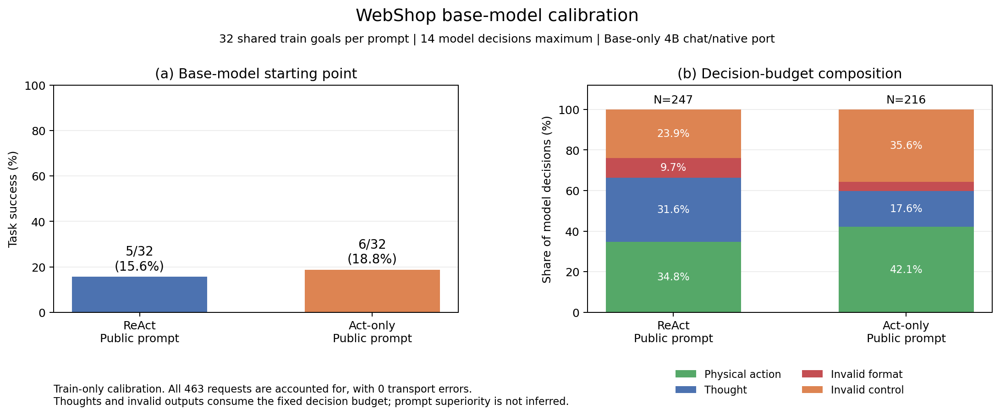

# WebShop 基础学生校准：完整结果

同一冻结基础学生Qwen3-4B-Instruct-2507、无adapter，32个共同train目标，各两套公开提示，共64回合。每回合最多14次模型决策、每次最多100生成token，使用独立基础模型服务和冻结的原版目录/索引。本轮用于校准执行链路与能力起点。

| 提示 | 成功数 | 成功率 | 平均归一化reward | 耗尽决策预算回合 |
|---|---:|---:|---:|---:|
| ReAct公开提示 | 5/32 | 15.625% | 0.412500 | 10 |
| Act-only公开提示 | 6/32 | 18.750% | 0.438021 | 10 |

两提示成功总数相差1；不从这一校准宣称提示优劣或显著性，也不把它视为经验选择机制已经在第二环境复现。后续学习对照需要独立训练经验、固定共同执行方式与预先冻结的评测任务。

## 实际决策与成本

| 提示 | 总决策/请求 | 物理动作 | 思考 | 格式无效 | 控制无效 |
|---|---:|---:|---:|---:|---:|
| ReAct公开提示 | 247 | 86 | 78 | 24 | 59 |
| Act-only公开提示 | 216 | 91 | 38 | 10 | 77 |

思考和无效输出均消耗模型决策预算；这些分类描述模型行为。463次模型请求全部记账，传输错误、待定请求和未知用量均为0，输入703,520 token、生成15,844 token。教师调用、eval与正式test回合均为0。

GPU时间243.564秒，上限3,600秒；控制器总耗时305.739秒，其中GPU启动前CPU准备62.174秒。控制器、环境worker与模型server均已正常退出，未自动重试。

[PDF](../pdf/webshop-development-pilot-v1/base-calibration.pdf) · [汇总副本](aggregate-summary.json) · [64回合/请求日志核对](../research-operations/20261113/webshop-pilot-complete-local-check.json) · [冻结协议](../../docs/WEBSHOP_DEVELOPMENT_PILOT_PROTOCOL_2026-11-13.zh-CN.md) · [绘图代码](../../scripts/plot_completed_followups.py)

权威生产结果保留在runs/webshop-development-pilot-v1/aggregate-summary.json；此目录的副本逐字节相同。原始回合、目标身份及请求内容保留本地。
